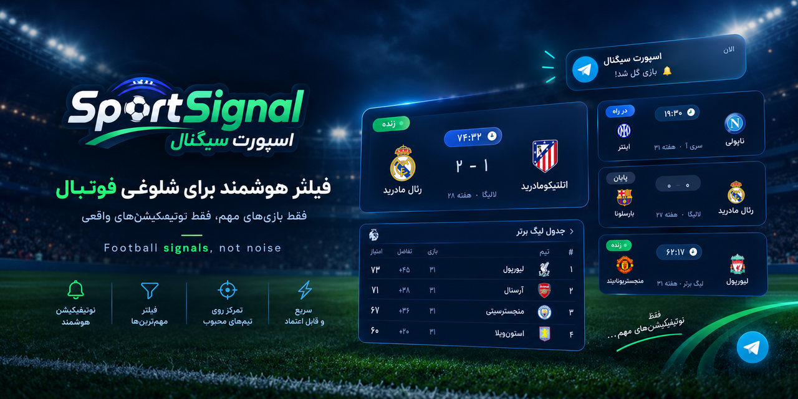

<!-- Banner: user-provided art (ChatGPT, 2026-09-15), optimized 1774×887 → 1280×640.
     The regeneration prompt that used to live in this slot is preserved in git
     history: `git show 759cec0:README.md` -->
<p align="center">
  
</p>

# ⚽ SportSignal — Persian Football Match Notifier

**A serverless Telegram bot + web page that tells Iranian football fans about the
matches that matter — before they start, while they're live, and the moment they end.**

> **Current build:** v13.51-rivalries · [Live](https://sportsignal.ir) ·
> **Operating it?** Read [`RUNBOOK.md`](RUNBOOK.md) first — deploy/verify/rollback,
> monitoring semantics, incident playbooks, and the never-do list (§11).

> **▶ WHERE TO CONTINUE — user note, kept verbatim (2026-09-15):**
> *"I am not sure how reliable Telegram bot is. If you want to work, work
> from here."*
> → Next focus: **Telegram bot reliability** — the delivery path
> (`src/bot.ts`, `src/telegram.ts`, `src/notifications.ts`, outbox recovery
> in `src/cron.ts`). Expanded in the status section below.

| | |
| :--- | :--- |
| **Live site** | https://sportsignal.ir — public match page (RTL, fa/en toggle, dark-first) |
| **Telegram bot** | [@SportSignalAlertsBot](https://t.me/SportSignalAlertsBot) — message `/start` to join; per-user teams + timezone + language |
| **Ops liveness** | `GET /healthz` — JSON; 503 pages external monitors |
| **Cost to run** | **$0/month** — entirely on free tiers (see [limitations](#current-limitations-the-free-tier-honest-numbers)) |
| **Stack** | Cloudflare Workers (TypeScript, zero framework) · KV · Workers AI · Football-Data.org + 2 fallbacks |

---

## Table of contents

1. [What this is](#what-this-is)
2. [How it works — the data pipeline](#how-it-works--the-data-pipeline)
3. [Tech stack and why](#tech-stack-and-why)
4. [Repository layout](#repository-layout)
5. [Bot commands](#bot-commands)
6. [Testing & deploying](#testing--deploying)
7. [House rules — the DOs and DON'Ts](#house-rules--the-dos-and-donts)
8. [Architecture decisions & why (project memory)](#architecture-decisions--why-project-memory)
9. [Status: done / deferred / never doing](#status-done--deferred--never-doing)
10. [Incident history (the war stories)](#incident-history-the-war-stories)
11. [Current limitations (the free tier, honest numbers)](#current-limitations-the-free-tier-honest-numbers)
12. [Upgrade path — what to buy, and when](#upgrade-path--what-to-buy-and-when)
13. [Secrets & configuration](#secrets--configuration)
14. [Monitoring (the $0 stack)](#monitoring-the-0-stack)

---

## What this is

SportSignal is a **curated filter for football noise**. It doesn't try to cover every
match in every league — it covers **UCL plus Europe's big leagues**, and it only
speaks up for what a fan would actually regret missing: countdowns into the big
matches, kickoff and result alerts for the teams you follow, weekly league tables,
and a morning digest on matchdays. Everything is **Persian-first** (Vazirmatn,
fa-IR dates, Persian digits) with a full English toggle.

Two surfaces, one Worker:

- **Telegram bot** — the product. 7 per-match notification types + big-match
  broadcasts + digests, per-user team follows, timezone, and language.
- **sportsignal.ir** — the public shop window. What the bot delivers, on a page:
  upcoming/live/finished matches, league standings, match cards, fa/en, RTL.

The non-negotiable product promise, inherited from every design decision in this
repo: **it is better to miss one notification than to spam.** (See
[decisions](#architecture-decisions--why-project-memory).)

---

## How it works — the data pipeline

### The tick (the heart)

One Worker, one cron trigger: `*/10 * * * *` UTC. Each tick runs the same ordered
pipeline (full source of truth: `src/cron.ts`):

```
execution_lock ─► drain outbox ─► refresh pool ─► fingerprint diff ─►
fan-out notifications ─► auxiliary legs ─► meters ─► completion blob ─►
dead man's switch ping
```

1. **Lock** (`execution_lock`, 240s TTL) — overlap guard. Long match-night ticks
   (6+ min wall) serialize; a queued tick skips cleanly.
2. **Drain the outbox** (`pending_sends_v1`) — Telegram sends that exhausted their
   3 in-line retries are re-sent with backoff. Write-first: the outbox record
   persists *before* the retry, so a crash mid-send can't duplicate or lose it.
3. **Refresh the match pool** — the CPU fix that ended the 2026-09-14 kills:
   - **Full 3-provider sweep at most every 2h** (all leagues, standings, long-view
     fixtures → KV pool `matches_v13_tracked`, 600+ matches).
   - **Active match windows** get a cheap *live* sweep between full ones.
   - **Quiet periods** reuse the pool; nothing fetches.
4. **Fingerprint diff** (`liveFingerprint`) — only genuinely-changed live data
   (goals, HT/FT status changes, new live matches) proceeds to status-change
   detection. Reordered-but-identical data is invisible noise.
5. **Cup big-team scan** (`maybeScanCupFixtures`, 13.50) — on non-sweep
   ticks, a marker-gated scan of the 6 English big teams' TheSportsDB team
   views keeps EFL Cup / FA Cup fixtures in the pool (the free league
   views regressed to 1 event each and sportscore's efl-cup feed went
   empty — the Liverpool–Tottenham miss). Adds fixtures, refreshes live
   scores/status during match windows.
6. **Fan out notifications** — 7 per-match types: `pre-match-72h` (big matches,
   both-teams-followed), `24h`, `3h`, `1h`, `5min` (big only), `match-start`,
   `result` — plus `match-start-big` / `result-big` broadcasts and table-top
   **coronation** alerts (a non-leader overtaking first place). Horizon
   ≈ **[-26h, +73h]** with backfill floors: ticks lost while a match was
   in-window **self-heal** on the next tick.
7. **Auxiliary legs** — FA-AI name learner, weekly league-tables digest
   (Mon 01:30–06:00 Tehran), morning digest, notification-gap audit,
   public payload prewarm.
8. **Meter itself** — true KV-write count/day, true subrequest totals
   (fetches + KV ops), notify breadcrumbs (found/sent/deferred/skipped).
9. **Completion blob** (`cron_status_v1`) — the tick's last write; what
   `/healthz` reads. The blob landing = the tick finished.
10. **Dead man's switch ping** — healthchecks.io per completed tick (see
   [monitoring](#monitoring-the-0-stack)).

### The anti-spam contract (read this twice)

Every send path — all 7 types, both broadcasts, the digests — follows the same law:

> **A send happens only AFTER its dedupe record persists to `notified_matches_v6`.
> A failed KV write suppresses the send. Silence beats spam.**

Dedupe key: `normHome|normAway|utcDate[:16]:<type>`, plus a per-isolate
MEM_DEDUPE set seeded **only on successful puts**. This is fail-closed and
failure-injection tested (a save that fails mid-tick leaves the send
retryable, never sent twice).

### The web page

`/api/public-matches` serves the public payload with **stale-while-revalidate**
(5-min fresh window, 10-min stale grace, background rebuild), backed by a
**7-day emergency snapshot** so the page survives provider outages. Cards
(`/api/card/:matchKey`) render as self-contained SVG (PNG via
`@resvg/resvg-wasm`, the repo's only runtime dependency).

### The FA-AI learner

Club names the static dictionary doesn't know get translated by Workers AI in
batches, grounded against a varzesh3 catalog, cached in KV — learned once,
displayed forever after. Gated ≥15 min apart and only writes its marker when
work actually happened (a 13.45 fix that stopped ~90 pointless writes/day).

---

## Tech stack and why

| Layer | Choice | Why this, specifically |
| :--- | :--- | :--- |
| Runtime | **Cloudflare Workers** (free tier) | Cron + HTTP + webhook in **one artifact**, no server to babysit, global edge. The free tier's ceilings shaped the whole architecture (see [limitations](#current-limitations-the-free-tier-honest-numbers)). |
| Language | **TypeScript, zero framework** | The free CPU ceiling (~10ms) makes every millisecond count. No framework = no framework overhead; esbuild via wrangler bundles ~31 modules from one entry. |
| State | **Cloudflare KV**, one namespace (`STATE`) | Free 1,000 writes/day. All live state is KV keys with documented contracts — pool, dedupe ledger, settings, meters. No database to operate. |
| Data | **Football-Data.org V4** + SportScore + TheSportsDB | 3-provider merge with canonical dedupe, 429 suspension circuits, Retry-After-honoring retry (capped 15s), degradation alerts. One provider dying degrades, never breaks. |
| Messaging | **Telegram Bot API** | The audience is already there. Webhook for commands; sends go through retry → 429 pause → outbox (write-first) so Telegram blips self-heal. |
| AI | **Workers AI binding** | Free neurons/day for the FA-AI learner. No external AI bill. |
| Rendering | **`@resvg/resvg-wasm`** (only runtime dep) | Match-card PNG without a browser or image service; WASM bundled via wrangler rules. |
| Monitoring | **healthchecks.io + UptimeRobot** | $0. Dead man's switch for the cron class; URL poller for the HTTP class. |
| Tests | **Plain Node scripts that eval-extract the REAL source** | The test harness (`scripts/lib/worker-src.js`) reads the same files wrangler bundles — **there is no drift between tested and shipped code**. 17 suites + tsc; 135 behavioral checks. |

---

## Repository layout

```
src/
  worker.ts        entry — thin re-export of api.ts (fetch + scheduled)
  types.ts         the Env contract (KV binding, secrets, AI binding)
  config.ts       VERSION + CONFIG (every KV key — the live-state contract)
  tables.ts        static dictionaries: stages/competitions/logos, provider id
                   maps, CSP headers, UCL starball (split in v13.47-seams)
  utils.ts         digits/dates/auth-hash/subrequest+kv-op meters/HTTP retry
  fa-dict.ts        static Farsi team dictionary (translation layer 1)
  translate.ts      3-layer translation + competition helpers (AI/admin/dict)
  fa-ai.ts          Workers AI Farsi-name learner (layer 2, KV-cached)
  matches.ts        windows, eligibility, notified-record KV (write-first)
  providers.ts       football-data / sportscore / thesportsdb chain + circuits
  telegram.ts       Bot API senders (retry / 429 pause / dead-chat / outbox)
  composers.ts      message + card composers, standings pipeline
  digest.ts         weekly tables / morning digest / big-match broadcasts
  notifications.ts  per-match notification engine + status-change detection
  users.ts          chat registry / member profiles / prefs / master list
  admin.ts          sessions / settings / clubs catalog / simulate fixtures
  public-matches.ts /api/public-matches pipeline (cache+lock+enrich+shape)
  bot.ts            Telegram webhook handler (/start /lang /follow /next …)
  cron.ts           the */10 tick (meter; governor; lock; pool; completion blob)
  monitoring.ts     cron status blob reader + phase-error alerts + live fingerprint
  migration.ts      bot-migration broadcast round logic
  auth.ts           admin login/logout/change-password (HMAC session cookie)
  public-swr.ts     /api/public-matches stale-while-revalidate endpoint
  card-route.ts     /api/card/:matchKey SVG/PNG rendering
  simulate.ts       POST /api/simulate notification-path harness
  admin-ops.ts      admin/ops API routes + legacy GET action endpoints
  api.ts            the HTTP router (route table + healthz + dispatch)
  pages/            PUBLIC / LOGIN / ADMIN HTML templates (shell only)
assets/             versioned client payload (core-*.js, public-*.js/css —
                   immutable, cache-bust by renaming), fonts, sw.js, icons
scripts/            the self-check suite (npm test) — eval-extracts REAL
                   source via scripts/lib/worker-src.js;
                   fa-names-from-wikipedia.js is a standalone data tool
design-system/      visual design MASTER doc (intent; implementation wins)
docs/              banner.png (the GitHub banner) + history/ session notes
```

## Bot commands

Persian-first, and **fully tappable** — a persistent button keyboard
(Featured / Upcoming / Tables / Teams / Timezone / Language / Help / Stop)
re-attaches to every reply, `/teams` is an inline tap-to-toggle grid with
✅ marks, and `/timezone` offers city quick-picks. Slash commands still work
(`/help` in-bot says it all in Persian):

| Command | Action |
| :--- | :--- |
| `/start` | Join & receive notifications (idempotent) |
| `/stop` | Leave |
| `/teams` | Followable teams with Persian names + numbers |
| `/follow 1,3,7` / `follow all` | Follow teams |
| `/next` | Upcoming matches for your teams (from the KV pool) |
| `/featured` | Today's big matches |
| `/timezone london` / `reset` | Set / reset your timezone |
| `/lang` | fa/en picker (persists to `user_prefs_v1`) |

---

## Testing & deploying

```sh
npm install
npm test          # tsc --noEmit + 17 check scripts; 135 behavioral checks
                  # that eval-extract the REAL src (no drift between tested
                  # and shipped code). MUST exit 0 before every deploy.
```

The deploy ritual (full detail in **RUNBOOK §2** — this order is law since
the [1101 incident](#incident-history-the-war-stories)):

```sh
npm test                                    # 1. suite green
npx wrangler dev &  # then curl /  /healthz  /nope  /api/card/nope  /admin
                                            # 2. local smoke (routes real?)
npx wrangler deploy                         # 3. ship
curl https://sportsignal.ir/healthz         # 4. version flipped + ok:true
# 5. watch the first tick's completion blob (healthz last_cron_age drops
#    below 10 again, subreq_last_tick sane, outbox 0)
```

Rollback if anything's off: `npx wrangler rollback` — the 13.47 incident
proved it recovers in ~90s with zero data loss.

---

## House rules — the DOs and DON'Ts

Enforced by tests where possible, by discipline everywhere else
(RUNBOOK §11 is the expanded version).

**Always DO:**

- `npm test` exit 0 → local smoke test (`wrangler dev` + curl) → deploy →
  verify healthz + first tick. Every time. No exceptions for "small" changes.
- Change any `src/*.ts` **signature or file list**? Co-evolve
  `scripts/lib/worker-src.js` (order + transforms) **in the SAME commit** —
  the harness *silently skips missing files*; `#seams` asserts exist precisely
  because a forgotten file once meant silent coverage loss.
- Bump versions together: `src/config.ts` `VERSION` ↔ `package.json`
  (`check-version-sync.js` fails `npm test` on drift) + a `CHANGELOG.md` entry.
- Use **npm**. The toolchain is npm; `package-lock.json` is the lockfile.
- After deploy: verify the first tick (see ritual above) before walking away.

**Never DO:**

- **Never rename KV keys.** They are live-state *contracts*
  (`notified_matches_v6` is the anti-spam ledger — renaming it re-sends the
  world's notifications). The full key table lives in RUNBOOK §5.
- **Never `bun install`** — it drops/wrongly-resolves `@resvg/resvg-wasm` and
  breaks card rendering. npm only.
- **Never edit `assets/core-*.js` casually** — it's the *live public payload*.
  (It still carries 18 inert i18n keys for the removed X card — documented
  dormancy; not worth the blast radius. See CHANGELOG 13.48.)
- **Never change anti-spam/dedupe logic without failure-injection tests**
  proving both directions (no dupes, no losses) under KV-write failure.
- **Never deploy un-tested or un-smoked.** The one time it happened
  (13.47's array elisions), it cost 90 seconds of 1101s.
- No rewrites, no frameworks, no new runtime dependencies. The constraints
  *are* the architecture.

---

## Architecture decisions & why (project memory)

The decisions that made this codebase what it is — kept here so future-you
doesn't have to re-derive them. (Full version-by-version narrative: CHANGELOG.)

| # | Decision | Why |
| :--- | :--- | :--- |
| 1 | **Fail-closed anti-spam** — write-first dedupe on every send path | The one product promise. A KV failure = silence (retryable), never spam. Failure-injection tested. |
| 2 | **KV keys are contracts, never renamed** | `notified_matches_v6` is the ledger of everything ever sent. A rename = every match's notifications re-fire. |
| 3 | **Tests eval-extract the real bundled source** | No fixture drift possible: what's tested is literally what ships (same file order wrangler bundles). |
| 4 | **Same-commit co-evolution** (src ↔ harness ↔ guards) | The harness silently skips missing files — split/move a module without updating it and tests go green while a module went dark. The `#seams` + `#xtrim` suites lock this. |
| 5 | **Quiet/live/full sweep split** (13.43) | The Sep-14 CPU kills (49 in 3 bursts) were full sweeps burning the rolling 10ms budget on quiet data. Split eliminated them — zero kills since. |
| 6 | **True meters before tuning** (13.44.1 "truemeter") | Every budget decision since is grounded in measured numbers (writes/day, subrequests, CPU), not estimates. |
| 7 | **Governor never gates anti-spam writes** | KV-budget shedding (SOFT 700) drops cosmetic writes only; the dedupe ledger is sacred even at HARD 850. |
| 8 | **Subrequest gates count fetches only** | Measured live (13.47): Cloudflare's 50-limit **does not count KV ops** (a 94-total-op tick ran clean). The in-code gates sit on the *enforced* counter — truthful, not paranoid. |
| 9 | **External dead man's switch** (healthchecks.io) | URL polling cannot see the cron class ("worker serves 200s but the tick died"). A missing ping can. |
| 10 | **X (Twitter) removed, not gated** (13.48) | X never ran (no secrets, no KV state — verified). Gating would break rule #3 (tests would test unshipped code); deferral isn't free (6 admin routes + OAuth code in every bundle). Removal = the no-drift principle applied. Restore path: revert + secrets, documented in `wrangler.toml`. |
| 11 | **Cron phase-extraction deferred** | Splitting the tick into named phases would rewrite the quota guarantee. Only revisit *with failure-injection tests first*. |
| 12 | **Modularization by seams, bodies byte-identical** (13.47) | api.ts 1101→312 lines via pure movement, route table conservation asserts, zero behavior change. The safe way to refactor a system with live users. |
| 13 | **Local smoke test before every deploy** | Born from the 1101 incident (legal TypeScript that only explodes at runtime). RUNBOOK §2 law. |
| 14 | **Persian-first, dark-first design** | The audience. Vazirmatn, fa-IR dates, Persian digits, RTL. See `design-system/ucl-notifier/MASTER.md`. |

---

## Status: done / deferred / never doing

**Roadmap (all shipped, tested, live-verified):**

- ✅ **13.45-sightlines** — truthful counters, healthz coverage, NaN fix,
  fa-ai marker gating, webhook sweep guard, dead man's switch
- ✅ **13.46-trim** — dead code purge (−11,200 lines), landmines removed
  (destructive `refactor:verify`, stale lockfile, 2MB dead asset), truthful docs
- ✅ **13.47-seams** — the monolith split: 8 focused modules, route table
  conserved, +22 structural test locks
- ✅ **13.48-xtrim** — the X path removed (see decision #10)
- ✅ **RUNBOOK.md** — 12 sections of operating truth
- ✅ **13.49-buttons** — the bot is fully tappable: persistent keyboard on
  every reply, `/teams` inline toggle grid, `/timezone` city quick-picks
- ✅ **13.50-cupscan + 13.50.1** — EFL/FA Cup big-team coverage via the
  TheSportsDB team view; scan moved to quiet ticks only after the 21:40Z
  real-subrequest-cap incident
- ✅ **13.51-rivalries** — named rivalry tags everywhere the derby tag lived
  (El Clásico, Der Klassiker, …); never in the UCL; fa keeps only
  ال کلاسیکو

**Deliberately deferred (documented, not forgotten):**

- `cron.ts` phase extraction / `kv-meter.ts` split — revisit only with
  failure-injection tests (decision #11)
- `assets/core-13.8.js` dormant X i18n keys — live public asset, zero
  functional cost (decision #10, CHANGELOG 13.48)
- `sched_v1:*` KV orphans (156 keys) — 7-day TTLs self-expire ~2026-09-22;
  deliberately not "cleaned up"

**▶ Next up (the continuation point, user-flagged 2026-09-15):**

- **Bot reliability hardening** — the user's words: *"not sure how reliable
  the Telegram bot is — work from here."* Verify the delivery path end-to-end
  (webhook → send retry/429 → dead-chat pruning → outbox recovery) before
  adding features. Baseline at the time of the flag: webhook healthy
  (`football.sportsignal.ir/webhook`, 0 pending updates, no last error),
  outbox draining clean, same-day alert deliveries — measure it, don't
  assume it.
- **R6** — live-sweep sportscore fan-out (2 days × 9 slugs = 18 fetches):
  the evening profile already sits at the real subrequest cap's edge
  (the 21:40Z incident).
- **R7** — cup-result sweeps via TSP `eventspast`, bounded to in-flight
  rows (fixtures + live covered by 13.50; FT pickup leans on hot-window
  quiet ticks today).

**Never doing (anti-goals):**

- No rewrite, no framework, no new runtime deps
- No KV key renames
- No anti-spam logic changes without failure-injection tests

**User-owned (not in this repo):**

- The external poller on `/healthz` (UptimeRobot or similar) — the
  recommendation is delivered; the account is yours.

---

## Incident history (the war stories)

The response loop is part of the system. Three incidents, three permanent fixes:

| Date | Incident | Root cause | Permanent fix |
| :--- | :--- | :--- | :--- |
| 2026-09-14 | 49 CPU kills (`exceededResources`) in 3 bursts | Full 3-provider sweeps on every tick burning the rolling 10ms CPU budget | 13.43 quiet/live/full sweep split — **zero kills since** |
| 2026-09-14 (era) | KV quota exhaustion | Every-tick coronation checks ≈ 1,000+ writes/day by themselves | 13.38 full-sweep gating + 13.44.1 truemeter + the governor |
| 2026-09-15 | **1101 on every request, 90s** | 13.47's first deploy shipped 18 legal-but-fatal array elisions (`,,`) in the admin route table | Rolled back in ~90s; **two permanent test gates** (zero-elision assert + entry/terminator count lock) + the RUNBOOK §2 smoke-test law |

(Also: the 2026-09-15 06:26 Telegram alert was triaged as a **non-incident** —
healthchecks.io's own recovery notification from the burn-test. DOWN + UP both
delivered = the dead man's switch verified end-to-end.)

---

## Current limitations (the free tier, honest numbers)

Everything below is **measured**, not estimated (see decision #6). Free-tier
ceilings, current burn, and headroom:

| Resource | Free limit | Measured burn | Headroom | Notes |
| :--- | :--- | :--- | :--- | :--- |
| **CPU** | ~10ms/req (rolling) | Quiet tick 35–50ms profile; full sweep ~98ms — soft-allowed while the rolling average stays low | **The thinnest margin** | The threat is a busier matchday (cards + broadcasts + sweeps) tipping the average. 13.43 made it survivable; the paid plan removes it. |
| **KV writes** | 1,000/day | Quiet 380–450; matchday 600–680 | Governor SOFT 700 / HARD 850 | Governor sheds cosmetic writes at SOFT; holds the pool write at HARD; **never** the anti-spam ledger. A true double-matchday (UCL + league evening) is the one to watch. |
| **Subrequests** | 50/invocation (fetches) | Quiet 25–28 fetches; sweep ~43 fetches (94 total incl. KV ops — **not counted by CF**, measured live) | Comfortable | In-code caps (48 fetch budget, prewarm <30, notify-defer >38) sit on the *enforced* counter. |
| **Wall time** | (not the binding limit) | Quiet ~50s; match-night ticks 6+ min | — | CPU is the limit, not wall; `execution_lock` serializes long ticks safely. |
| **Workers AI** | Free neurons/day | FA-AI batches, gated ≥15 min | Comfortable | The learner runs only when new names exist. |
| **Football-Data** | 10 req/min | 2h full sweeps + live windows | Comfortable | 429 suspension circuit + pool fallbacks already handle overage. |
| **Bus factor** | — | 1 operator, 1 admin | — | Mitigated by this README, RUNBOOK, CHANGELOG, and the $0 monitoring. |

**Known blind spots** (documented in RUNBOOK §6): in-flight ticks still serve
200 on healthz (completion-aware ages resolve the ambiguity); provider quality
is only visible via `/api/status`; Telegram outages surface as outbox depth
(alerts at ≥50).

---

## Upgrade path — what to buy, and when

Spend money only when a measured trigger fires, in this order:

| Buy | Cost | Trigger | What it buys |
| :--- | :--- | :--- | :--- |
| **Cloudflare Workers Paid** | **$5/mo** | *Any* recurrence of CPU kills on matchdays — or before scaling to more leagues/users | **30s CPU** — permanently deletes the thinnest-margin threat (the whole reason the sweep split exists). Also removes the 1,000 KV writes/day cap (usage-billed instead). This is the single highest-ROI purchase. |
| **Football-Data.org paid tier** | ~€?/mo | Wanting more competitions or tighter refresh than 2h | More req/min + more competitions. The fallback chain already makes this optional. |
| **healthchecks.io paid** | $5/mo | Wanting SMS/Slack alerts or more checks | The free Telegram alerts are already the critical path; upgrade only if Telegram itself becomes the risk. |
| **UptimeRobot paid** | ~$6/mo | Wanting <5-min poll intervals | Free 5-min polling already matches the /healthz semantics (30/35-min staleness gates). Low priority. |
| **A second admin/operator** | trust | You, unavailable for >a day | Not a purchase, but the real bus-factor fix: RUNBOOK was written so a stranger can operate this. Share the credentials vault, not the workload, as needed. |

Nothing else is worth buying. The architecture is already shaped *around* the
free tier's constraints — the paid plan relaxes the constraints, it doesn't
replace the design.

---

## Secrets & configuration

Secrets live in wrangler (`wrangler secret put …`), never in vars or git:

```
BOT_TOKEN              # the Telegram bot
API_TOKEN              # football-data.org
ADMIN_TOKEN            # admin API bearer
ADMIN_PASS             # admin panel login
WEBHOOK_SECRET         # Telegram webhook auth
HEALTHCHECK_PING_URL   # optional — absent = no-op
```

Vars/bindings in `wrangler.toml`: `TEHRAN_TZ=Asia/Tehran`, the `STATE` KV
binding, the `AI` binding. (The former X path's secrets are gone with 13.48;
restore path documented in `wrangler.toml`.)

## Monitoring (the $0 stack)

- **healthchecks.io** — dead man's switch. Cron `*/10` UTC, 20-min grace,
  Telegram alerts. The Worker pings on every completed tick and `/fail`s with
  the error name on caught exceptions. Catches what URL polling can't:
  the cron stopping.
- **UptimeRobot** (or any poller) — `GET /healthz` every 5 min. 503 means
  stale heartbeat (>30m) or stale completion (>35m) or outbox ≥ 50. Catches
  what the switch can't: the HTTP surface being down.
- **In-band** — `degraded: true` on healthz is the early-warning band; the
  bot heartbeats to the admin chat every 6h; the gap audit alerts
  (rate-limited) on notification losses.

RUNBOOK §5 has the full alert-semantics matrix (which watcher catches which
failure class); §6 the blind spots.

---

*Built for the matches that matter. See
[`CHANGELOG.md`](CHANGELOG.md) for the full history (version by version, newest
first), [`RUNBOOK.md`](RUNBOOK.md) for operations, and
[`design-system/ucl-notifier/MASTER.md`](design-system/ucl-notifier/MASTER.md)
for the design intent.*
