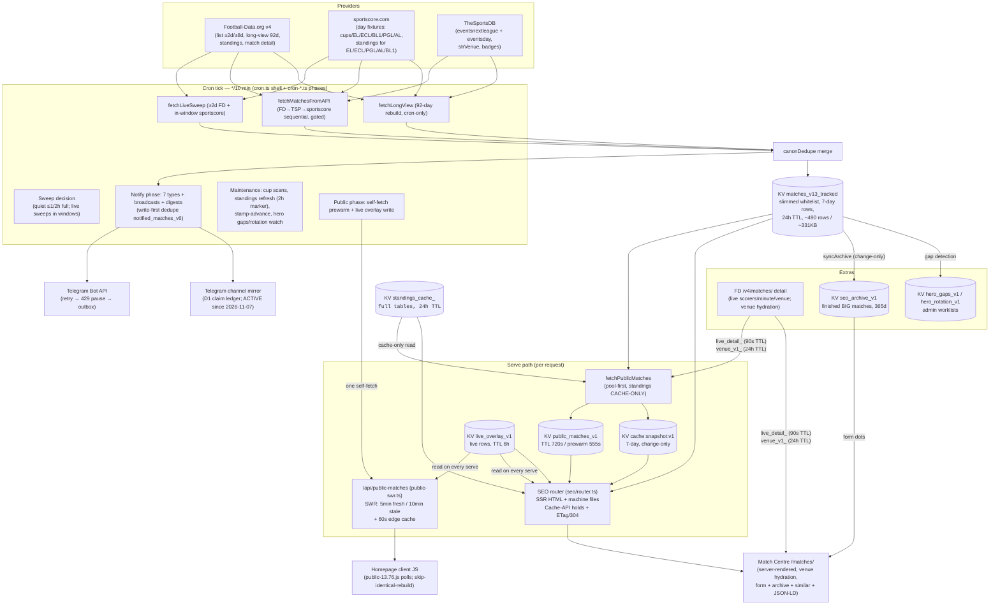

# SportSignal — API & Data Efficiency Audit Report

> Agents: read AGENTS.md in the repo root first, and follow it for this whole task.

**Audit type:** Read-only discovery audit per `SPORTSIGNAL-API-DATA-AUDIT-SPEC.md`
**Audited commit:** `e4973cccefa8a71530dc3f71a4d86c1e55f8fab0` on branch `main` (commit "Add files via upload", 2026-11-09 06:39 +0330)
**Audit date:** 2026-11-09 (03:00–05:30 UTC)
**Deployed version at audit time:** `13.249-ranktip` (live `/healthz`) — identical to this commit's `src/config.ts` `VERSION`, so live behavior matches the audited tree.
**Scope of this report:** APIs, cached data, provider responses, and the Match Centre (`/matches/<slug>`) data path. No application files were changed. The only repository change made by this audit is this report file.

---

## 1. Executive summary

SportSignal is a single Cloudflare Worker (`ucl-notifier`) that serves the Persian-first football site **sportsignal.ir**, the Telegram bot, and a 10-minute cron pipeline from one artifact. All match data flows through one KV "pool" (`matches_v13_tracked`) that is refreshed from three providers (Football-Data.org v4, sportscore.com, TheSportsDB), slimmed to a strict field whitelist at write time, and then shaped into one public JSON payload (`/api/public-matches`, ~128 KB measured) that feeds both the client-rendered homepage and the server-rendered SEO pages — including the Match Centre.

**The most important conclusions:**

1. **The system already knows a lot more than it shows.** The KV pool holds ~490 matches (measured) across six leagues plus cups, but the public payload surfaces only "big/followed/top-table" rows. Full league tables (all 18–20 teams with points, played, W/D/L, goals for/against, goal difference, crests) sit in `standings_cache_<CODE>` KV keys and are already read during match-page rendering — yet the Match Centre only prints a small season chip per team. Points, goal difference, and a 5-row table neighborhood are one function call away (`teamStandingsWindow` already exists and is used on team pages, not match pages).
2. **Goal-scorer lists for recently finished matches are already stored in KV but deliberately blanked at serve time.** `scorers` survives in the pool whitelist; `pubMatch()` empties it for any non-live row. A finished match that was seen live by a sweep still carries its scorers in the pool for ~7 days.
3. **The exact "duplicated venue wording" symptom from the spec is reproducible live today** and root-caused: the answer sentence prepends «ورزشگاه» while the curated Persian stadium names already begin with «ورزشگاه», producing «ورزشگاه ورزشگاه آلیانز آرنا» (double wording) in the visible answer card and the JSON-LD description. Fixing it is a zero-cost string change (conceptually).
4. **The W/D/L Persian-label symptom is NOT reproducible** in the current code or live response — form dots render as ب/م/ش with a legend and Persian-digit summaries.
5. **The pool is deliberately slim.** Football-Data responses include half-time scores, referees, odds, team short names, and more — all discarded at the pool write to keep the ~331 KB blob cheap to parse (a prior 617 KB pool contributed to 1,007 CPU-killed invocations). Any "free field" recommendation that re-grows the pool has a real CPU cost and must be treated carefully.
6. **The operational envelope is tight but well-mapped.** Free-tier limits: ~10 ms CPU (rolling average), 1,000 KV writes/day, 50 subrequests/invocation (fetches only), FD 10 req/min. Measured burn today at 03:14 UTC: 139 KV writes (83 from web), 29 true subrequests on the last tick, 490 pool matches, pool 74 minutes old. Adding provider calls per page view is the one thing this architecture must never do again — the code comments document three production incidents that resulted from exactly that.

**The five best low-cost opportunities (detailed in §14):**

| # | Opportunity | Classification | Incremental cost |
|---|---|---|---|
| 1 | Fix duplicated «ورزشگاه ورزشگاه…» venue wording on match pages | A (data-quality bug) | Zero requests / zero KV / negligible CPU |
| 2 | Show final score + goal scorers on finished Match Centre pages (from pool rows already in KV) | B | Zero requests / zero KV / negligible CPU; partial coverage (only matches seen live) |
| 3 | Add points, goal difference, and a 5-row league-table window to the Match Centre (reuse `teamStandingsWindow` + the `fullByCode` read that already happens) | B/D | Zero requests / zero KV / negligible CPU |
| 4 | Group "بازی‌های مرتبط" (related fixtures) by same round/stage — data already computed by `similarMatches` (stage-0 candidates) | D | Zero requests / zero KV / negligible CPU |
| 5 | Split the existing form card into home/away form and add goals for/against in the sample — same rows the form card already reads | D | Zero requests / zero KV / negligible CPU; sample-size labeling required |

**The most important risks:** (a) the 10 ms rolling CPU budget makes any per-request JSON.parse growth or per-page provider fetch dangerous (three documented incident classes); (b) form/H2H data derived from the archive covers only "big" matches, so completeness claims would be dishonest without labels; (c) several runtime metrics (per-route CPU, per-endpoint KV reads under crawler load) are not instrumented and can only be class-profiled.

---

## 2. Repository and audit scope

| Item | Value |
|---|---|
| Repository | `https://github.com/assadigit/sportsignal` |
| Branch / commit audited | `main` @ `e4973cccefa8a71530dc3f71a4d86c1e55f8fab0` |
| Working tree at start | Clean (`git status` — nothing to commit) |
| Repo instructions read | `AGENTS.md` (all 14 sections incl. project-specific §14), `README.md`, `docs/RUNBOOK.md` (all 13 sections), `docs/SCHEDULER.md` (referenced), `CHANGELOG.md` (skimmed, newest entries) |
| Spec | `SPORTSIGNAL-API-DATA-AUDIT-SPEC.md` (all 513 lines) |
| Source files read in full or in targeted depth | `src/api.ts`, `src/admin-ops.ts`, `src/config.ts`, `src/public-matches.ts`, `src/public-swr.ts`, `src/providers.ts`, `src/provider-fd.ts`, `src/provider-tsp.ts` (normalizer), `src/provider-sportscore.ts` (normalizer), `src/match-pool.ts`, `src/composers.ts` (standings), `src/cron.ts`, `src/grounds.ts`, `src/seo/router.ts`, `src/seo/data.ts`, `src/seo/pages.ts`, `src/seo/files.ts` (archive), `src/seo/jsonld.ts`, `src/seo/page-shell.ts` (script inventory), `src/seo/config.ts` (TTLs), `src/card-route.ts`, `src/monitoring.ts` (pool meta), `wrangler.toml` |
| Commands used (all local, read-only) | `git clone/branch/rev-parse/status/log`, `grep`/`rg`, `wc`, `sed`, `python3` (local file inspection), `curl` (5 public GETs, see below) |
| Live public requests made (spec §2.2 allows one per public endpoint; no cache-busting; no private endpoints) | `GET /healthz` (03:14:34Z), `GET /api/public-matches` (03:14:41Z), `GET /matches/bayern-munich-vs-1-koln-2026-11-20` (03:14:50Z), `GET /api/matches.json` (03:15:27Z). All returned 200; headers recorded in §10. |
| Commands/checks deliberately skipped | `npm install` / `npm test` (not needed to validate a markdown-only change; the suite eval-extracts real source and co-evolves with code — no code changed, so it cannot regress by this report); `npx wrangler dev`/`deploy` (deploy is forbidden by spec); any `wrangler kv`/Cloudflare API call (production state access not needed — all KV shapes verified from source); any Telegram/football-data API call; any admin/diag endpoint; load tests. |
| Limitations | (1) A concurrent agent is working on UI/UX changes in this repo (per the product owner); this audit is pinned to the commit above and any push races are handled by fetch-before-push discipline (AGENTS.md §14 hard rules). (2) Runtime CPU per route is not instrumented in the product; only class profiles from RUNBOOK §7 and two incident notes exist. (3) KV values were inspected from source code + the public payloads they produce, not by reading the KV store directly (no production state access was requested). (4) The bot surface was audited from source (composers/digests/notify-engine), not by exercising the live bot. |

No secrets, tokens, cookies, or private user data appear in this report. Credentials supplied for repository access were used for clone/push only and are not stored in the repository (one-shot push URL, per AGENTS.md §7/§14).

---

## 3. Verified architecture

Single Cloudflare Worker, TypeScript, zero framework. One artifact serves: the public website (SSR HTML + one JSON API), the Telegram bot webhook, admin/ops APIs, and the scheduled pipeline. State: one KV namespace (`STATE`), two D1 databases (stats, users), Workers AI binding, and a self-referencing service binding (`DRAIN_SELF`) for the kickoff-drain chain. Static assets (versioned `public-*.js/css`, `core-*.js`, fonts, emblems, player portraits) are served by Workers Static Assets before the worker runs.

**Verified data flow (all edges source-verified; none marked unknown):**



**Key structural facts (verified):**

- The **Match Centre page is fully server-rendered** from KV data. Its only scripts are a theme-init snippet, the cookieless `/api/visit` beacon, the Cloudflare analytics beacon, and one inline countdown/copy script (`src/seo/pages.ts:180-186`). It makes **no client-side API request** — unlike the homepage, whose client JS polls `/api/public-matches` at `pollHint` cadence (60 s live/pre-match, 900 s idle; measured idle hint 900).
- Website and bot share the same pool and payload builders (ADR-001 "website as truth"): `pubMatch()` shapes rows for the public API; `pickHeroMatches`/`isFeaturedMatch` etc. (`src/match-classify.ts`) drive both the site hero and the bot's `/featured`.
- The pool is written **slim** (whitelist in `src/match-pool.ts:77-98`): `id, utcDate, status, venue, stage, matchday, round, roundRaw, roundFa, minute, scorers, score.fullTime, homeTeam/awayTeam {name, crest, faName}, competition {code, faName, emblem}`. Everything else FD sends is dropped at write (see §5 category C).
- Two scheduled triggers: `*/10 * * * *` (the tick) and `27 */4 * * *` (lean far-cup probe, `wrangler.toml:63-64`, `src/api.ts:424-434`).
- Hidden leagues (`SITE_HIDDEN_LEAGUES: ["AL"]`) flow into the pool but are filtered from every public surface (`src/config.ts:32`, `src/seo/data.ts:78`, `src/public-matches.ts:545`).

---

## 4. Complete API endpoint inventory

Access legend: **P** = public (no auth), **A** = admin-gated (session cookie or `ADMIN_TOKEN` bearer; the `/api/` prefix sits behind the admin gate in `src/api.ts:318,363-368`), **B** = bot/webhook, **I** = internal (service-binding or cron only), **H** = health/diagnostic.

### 4.1 Public website pages (SEO router — `src/seo/router.ts:465-795`)

| Method + path | Access | Handler | Purpose | Response shape | Data source | Freshness | Consumer | Cost | Evidence |
|---|---|---|---|---|---|---|---|---|---|
| GET `/` | P | `buildHomePage` (router.ts:116-384) | Homepage: hero/match card, live, topspot, UCL, week, standings, cups, finished | HTML (~SSR + placeholders the client re-renders) | KV payload + overlay (`getSeoCtx`) | Edge hold ≤300 s; `s-maxage=60, SWR 300` | Visitors + client JS | ~11-13 KV reads per render (§6); 0 provider calls | router.ts:116, 699-703 |
| GET `/matches` (paginated) | P | `buildMatchesPage` (pages.ts:433) | Big upcoming matches listing | HTML | `getSeoCtx` pool | Hold 900 s; 300 s if any live row | Visitors | same | router.ts:704-709 |
| GET `/matches/today`, `/matches/tomorrow`, `/matches/this-week`, `/matches/this-weekend` | P | `buildTodayPage`/`buildTomorrowPage`/`buildThisWeekPage`/`buildWeekendPage` (pages.ts:575-618) | Time-hub listings (all followed fixtures in window) | HTML | `getSeoCtx` pool | 900 s hold (300 s when live) | Visitors | same | router.ts:710-716 |
| GET `/matches/<slug>` | P | `buildMatchPage` (pages.ts:259-393) | **Match Centre page** (see §6) | HTML (measured 44,855 B) | `getSeoCtx` + archive + standings cache + venue hydration | Live 120 s; upcoming lapses at kickoff+120 s; finished 900 s | Visitors, crawlers | ~15-16 KV reads cold + ≤1 FD fetch (venue, KV-cached 24 h) | router.ts:717-735; seo/config.ts:87-90 |
| GET `/teams`, `/teams/<slug>` | P | `buildTeamsIndexPage` / `buildTeamPage` (pages.ts:638, 725) | Team index / team page (fixtures, form card, standings window) | HTML | `getSeoCtx` + archive + up to 2 full standings reads | 900 s hold | Visitors | same class | router.ts:736-744 |
| GET `/competitions`, `/competitions/<slug>` | P | `buildCompetitionsIndexPage` / `buildCompetitionPage` (pages.ts:831, 907) | Competition index / full standings table page | HTML | `getSeoCtx` + cache-only `fetchStandings(code,false)` | 900 s hold | Visitors | same class | router.ts:745-753 |
| GET `/about`, `/methodology`, `/contact`, `/privacy`, `/terms`, `/data`, `/sitemap` | P | `pages-static.ts` builders | Trust/static pages | HTML | static + `fetchedAt` | 900 s hold | Visitors | 1 `getSeoCtx` (pool lists for nav freshness) | router.ts:754-760 |

### 4.2 Public machine files (SEO router)

| Method + path | Access | Handler | Purpose | Data source | Freshness | Evidence |
|---|---|---|---|---|---|---|
| GET `/robots.txt` | P | `F.robotsTxt` | Crawl rules | static | 3600 s | router.ts:527-535; files.ts:96 |
| GET `/sitemap.xml` + `/sitemaps/{pages,competitions,teams,matches-upcoming,matches-archive}.xml` | P | `F.buildSitemapIndex` / `F.buildSitemap` | Sitemaps with honest lastmod (`seo_lastmod_v1`) | KV payload+pool+`seo_lastmod_v1` | 600 s + ETag; IndexNow ping on changed URLs | router.ts:626-646; files.ts:6-8 |
| GET `/calendar.ics`, `/feed.xml` | P | `F.buildCalendar` / `F.buildFeed` | Calendar/Atom of upcoming big matches | KV payload | 300 s + ETag | router.ts:647-658 |
| GET `/api/matches.json` | P | `F.buildMatchesJson` | Public machine-readable fixtures feed (measured 60,726 B) | KV payload (upcoming + recent finished, EN+FA names, venue, score, canonical URL) | `max-age=60, s-maxage=300` + ETag | router.ts:659-673 |
| GET `/llms.txt`, `/llms-full.txt` | P | `F.buildLlmsTxt` / `buildLlmsFullTxt` | AI-assistant docs | static + data descriptions | 3600 s + ETag | router.ts:536-538, 619-624 |
| GET `/.well-known/security.txt`, `/BingSiteAuth.xml`, `/<IndexNow-key>.txt` | P | files.ts builders | Security/auth/key files | static | 3600-86400 s | router.ts:539-556 |
| GET `/og/match-<slug>.png` | P | `F.buildMatchOgPng` | Text-only per-match OG image | KV (match lookup by slug) | `max-age=3600` | router.ts:675-688 |

### 4.3 Public JSON API + assets

| Method + path | Access | Handler | Purpose | Response shape | Data source | Freshness | Consumer | Cost | Evidence |
|---|---|---|---|---|---|---|---|---|---|
| GET `/api/public-matches` | P | `handlePublicMatchesApi` (public-swr.ts:22-159) | The public payload (measured 130,755 B) | `{upcoming[], finished[], heroMatches[], nextBig, topSpot{next,matches[]}, thisWeek[], nextWeek[], standings{6 codes × top-8}, cups[8], ucl{teams[],matches[]}, fetchedAt, pollHint, schedMode, (liveAt/swr/cachedAt flags)}` — rows via `pubMatch` (§5) | KV payload + overlay; rebuild pool-first, standings cache-only | KV 720 s TTL; SWR 5 min fresh/10 min stale; 60 s edge cache | Homepage client JS (primary), anyone | Fresh serve: 2 KV reads + overlay patch; rebuild: ~15 KV ops, 0 provider fetches (pool-first) | public-swr.ts:77-137; public-matches.ts:433-932 |
| GET `/api/card/<matchKey>[.svg|.png]` | P | `handleCardRoute` (card-route.ts:11+) | Visual match card (SVG; PNG via resvg-wasm) | image | KV pool → payload fallback | per-render, memoized PNG | Bot photos, OG | 1-2 KV reads + (PNG) wasm render | card-route.ts:11-60 |
| GET `/api/visit` | P | `handleVisitBeacon` (stats.ts:230+) | Cookieless page-view beacon (bot-filtered) | JSON counters | D1 STATS_DB | n/a | All pages (inline beacon) | 1 D1 upsert (async, `waitUntil`) | api.ts:327-331; stats.ts |
| GET `/healthz` | P (CORS `*`) | api.ts:64-184 | Liveness + budget telemetry | JSON: ok, ages, outbox, pool age/size, kv writes (cron+web), subreq/kv-ops last tick, scheduler verdict, version | KV `cron_status_v1` + pool meta text-scan + `kv_writes_web_v1` | `no-store` | UptimeRobot, dashboards | 3-4 KV reads (pool read is a text scan, NOT a parse — v13.111) | api.ts:64-184; monitoring.ts:32-44 |

### 4.4 Admin / ops / bot / internal (inventoried, not invoked)

| Method + path | Access | Purpose | Evidence |
|---|---|---|---|
| POST `/webhook` | B (`WEBHOOK_SECRET`) | Telegram update router (`handleTelegramUpdate`) | api.ts:299-317; bot.ts |
| POST `/api/kickoff-drain` | I (service binding + secret) | Deferred fan-out drain (fresh subrequest budget) | api.ts:332-343; kickoff-drain.ts |
| GET/POST `/admin`, `/admin/login`, `/admin/logout`, `/admin/change-password` | A/P(login form) | Admin panel + HMAC session | api.ts:322-325, 55-59; auth.ts |
| GET `/api/members` | A | Bot member roster | api.ts:185-192 |
| GET `/api/standings?code=` | A | Fresh standings + position deltas (10-min freshness) | api.ts:193-210 |
| GET `/api/status` | A | Version, source, user count (masked chat ids), leagues | api.ts:211-231 |
| GET `/api/stats` | A | Visitor stats (D1) | api.ts:236-239; stats.ts |
| ANY `/api/sources` | A | Probes all three providers live (match counts + samples) — **triggers provider requests on demand** | api.ts:240-262 |
| ANY `/api/webhook/info`, `/api/bot/info`, POST `/api/webhook/setup` | A | Telegram webhook admin | api.ts:264-286 |
| GET/PUT `/api/settings` | A | Bot settings (teams, toggles) | admin-ops.ts:269-289 |
| GET `/api/fa-teams` (+ `?run=1`, `?forget=`), POST `/api/fa-teams/override` | A | FA-AI learner status/controls, manual translation overrides | admin-ops.ts:291-361 |
| POST `/api/broadcast`, POST `/api/test` | A | Broadcast / test message to all chats (real Telegram sends) | admin-ops.ts:363-373, 436-443 |
| POST `/api/migrate/start|stop`, GET `/api/migrate/status` | A | Bot migration broadcast control | admin-ops.ts:378-413 |
| GET `/api/clubs?q=` | A | Club-name autocomplete catalog (provider rosters, 14-day cache) | admin-ops.ts:415-434; admin.ts |
| GET `/api/hero-gaps`, `/api/hero-rotation` | A | Portrait gap / transfer-watch worklists | admin-ops.ts:448-478 |
| GET `/api/audit` | A | Notification-gap audit + channel health | admin-ops.ts:479-500 |
| ANY `/api/diag-public` | A | Live vs pool WORTHY/reportable verdicts (runs live sweep) | admin-ops.ts:502-531 |
| ANY `/api/diag-fd` | A | Raw FD probe (1 FD request per call) | admin-ops.ts:533-556 |
| POST `/api/simulate` | A | Notification-path simulation harness | simulate.ts:20+ |
| GET `/debug-notifications`, `/next-matches`, `/clear-notifications`, `/clear-locks`, `/health`, `/trigger`, `/simple-test`, `/send-tables`, `/teams` (shadowed by SEO page), `/` (root action) | A (legacy actions) | Legacy GET ops endpoints — `/trigger` runs a full tick, `/clear-*` delete state, `/send-tables` queues the weekly digest | admin-ops.ts:37-266; router.ts:455-458 |

### 4.5 Scheduled handlers

| Trigger | Handler | Work | Evidence |
|---|---|---|---|
| `*/10 * * * *` | `executeScheduledLogic` (cron.ts:27-245) | Preflight (settings/budget) → users (outbox/heartbeat/migration/FA-AI) → weekly digest window → pool phase (sweep decision) → notify phase (fan-out, reservations) → maintenance (cup scans, standings refresh, stamp-advance) → public phase (prewarm self-fetch + overlay) → completion blob | cron.ts; wrangler.toml:64 |
| `27 */4 * * *` | `probeCupFarFixtures` (api.ts:424-434) | Lean far-cup fixture probe (~10 subrequests: pool read + 7 sportscore probes + pool write) | providers.ts; wrangler.toml:64 |

### 4.6 Inventory observations (duplication / over-fetch / unclear freshness)

- **Data duplicated across endpoints:** the same match rows appear in `/api/public-matches` (all lists), `/api/matches.json` (subset, snake_case), SSR homepage HTML, hub pages, and `/api/card/*`. This is intentional (server/client parity + machine feeds), all sourced from the same KV payload — no extra provider cost, only render cost.
- **Endpoints that do work on request (admin-gated only):** `/api/sources` (3 provider sweeps), `/api/diag-public` (live sweep), `/api/diag-fd` (1 FD call), `/trigger` (full tick), `/api/standings` (fresh FD standings fetch + snapshot write). None are public.
- **Public request path provider calls:** exactly one remains — the match-page venue hydration FD detail call (bounded: numeric-FD-id only, one attempt, 5 s race, KV-cached 24 h positive AND negative). Everything else on the public path is KV/Cache-API only. This is the direct product of the v13.52/v13.55/v13.97 incidents.
- **Freshness behavior that is subtle (documented, not broken):** `/api/public-matches` edge-caches for 60 s, so a client poll can be up to 60 s + overlay-cadence (~10 min) behind live truth; the payload itself carries `liveAt`/`swr`/`cachedAt` flags to disambiguate.

---

## 5. Data catalogue (A/B/C/D/E/F)

Classification key (spec §3.3): **A** already public · **B** already cached/stored but not exposed (in the relevant public response) · **C** present in an existing provider response but discarded/not normalized · **D** cheaply derivable from cached data · **E** requires a new upstream request · **F** unknown/insufficient evidence.

### 5.1 Match identity & schedule

| Data item | Example fields | Class | Existing source | Current consumer | Potential Match Centre use | Freshness | Incremental cost | Confidence |
|---|---|---|---|---|---|---|---|---|
| Provider match id | `id` (FD numeric; `spsc-*`, `tsd-*` prefixed) | A | `pubMatch` (`public-matches.ts:126`) | card route lookup, overlay match | Internal only; exposing raw ids has no fan value | pool 24 h | zero | High |
| Competition + code | `competition.code/faName/emblem` | A | `pubMatch:136` | everywhere | already shown | payload ≤12 min | zero | High |
| Kickoff UTC + Tehran + Jalali + Gregorian | `utcDate`; derived `faDateD1/D2`, `faTime`, `utcTime` | A | `pubMatch:129`; seo/utils | match page facts + answer sentence | already shown | same | zero | High |
| Stage / round | `stage`, `round`, `roundRaw`, `roundFa` (null for league rows) | A | pool whitelist; `roundLabel` (public-matches.ts:31-101) | chips on cards, match page «مرحله» row (only when non-null) | same-round grouping (see §8) | pool | zero | High |
| Matchday (numeric) | `matchday` | **B** | pool whitelist (`match-pool.ts:80`) — kept in KV but NOT emitted by `pubMatch`; used internally by `similarMatches` (seo/data.ts:570,583) | internal only | "Matchday N of M" caption / grouping sibling fixtures | pool | zero (already in KV) | High |
| Status + status detail | `status` (TIMED/SCHEDULED/IN_PLAY/PAUSED/FINISHED/POSTPONED/SUSPENDED/CANCELLED) | A | `pubMatch:137` + stale-live guard | status chips, JSON-LD eventStatus | already shown | overlay ~10 min live | zero | High |
| Venue name (EN+FA) | `venue`, `venueFa` | A | `pubMatch:122-124` (provider venue → `TEAM_STADIUMS` fallback); match-page hydration (`seo/data.ts:340-395`) | chips, match page, Maps link | already shown; **bug: duplicated «ورزشگاه» wording** (§11.1) | venue cache 24 h | zero | High |
| Venue city/country/capacity/coordinates | — | **F/E** | No source anywhere in the repo (TEAM_STADIUMS carries names only; FD returns name only) | none | would need a new curated static table (zero runtime cost, manual maintenance) or a new provider | n/a | new static data or new requests | High (that it's absent) |
| Neutral-ground flag | — | **D** | derivable: `isOneOffNeutral(stage, roundRaw)` (grounds.ts:36-40) already computed during venue resolution | implicit (skips home-ground table) | "one-off neutral venue" note on finals | pool | negligible | High |
| Last-updated (data epoch) | `fetchedAt` (pool stamp), `liveAt`, `cachedAt` | A | payload + `M.lastUpdatedHtml` | "Last updated" line | already shown | payload | zero | High |

### 5.2 Teams

| Data item | Example fields | Class | Existing source | Current consumer | Potential Match Centre use | Freshness | Incremental cost | Confidence |
|---|---|---|---|---|---|---|---|---|
| Team names EN+FA + crest | `homeTeam/awayTeam {name, faName, crest}` | A | `pubMatch:127-128` | everywhere | already shown | payload | zero | High |
| **Team competition rank** | `homeTeam.rank`, `awayTeam.rank` (fixture's own competition) | A | `attachTeamRanks` (public-matches.ts:232-241) from cache-only standings | client cards + SSR mirrors (v13.248) | already shown on cards; could extend to match page head | standings cache 24 h | zero | High |
| Team short name / TLA / provider id | `shortName`, `tla`, `id` | **C** | present in FD response; dropped by pool slim (match-pool.ts:60-76 comment) | none | marginal (monogram fallback already exists) | n/a | pool re-growth (~sizeable); not recommended | High (that it's discarded) |
| Hero portrait assets | `HERO_COVERAGE_RAW.wired` (111 clubs; `assets/players/**`) | A (server-side lookup) | `heroArtSrv` (seo/router.ts:35-41); client `heroArtFor` | homepage hero card | Match Centre hero art for the two clubs (both sides' portraits) — asset library exists | static (deploy-time) | zero runtime (static lookup) | High |
| Club metadata beyond names/crests (country, founded, stadium capacity) | — | **F** | not present in any current payload/cache (clubs_catalog is name+crest only — admin.ts) | none | would need new data (E or curated static) | n/a | unknown | Medium |

### 5.3 Form & performance

| Data item | Example fields | Class | Existing source | Current consumer | Potential Match Centre use | Freshness | Incremental cost | Confidence |
|---|---|---|---|---|---|---|---|---|
| Recent form (last-5 W/D/L per side) | dots `{r, oppFa, score, date}` | A | `teamForm` (seo/data.ts:519-562) from pool FINISHED rows (7 d) + `seo_archive_v1` (365 d, BIG matches only), min-3 gate | match page «فرم اخیر» card, team page | already shown | pool/archive | zero | High |
| Season record chip | `pos/played/won/draw/lost/points` | A | `teamSeasonRecord` (seo/data.ts:464-507) from standings compacts + full cache + UCL table | match page form strip (won/draw/lost + pos + played shown) | **points, gf/ga/gd not shown though available in the same source** (§8) | standings 24 h | zero | High |
| Home-only / away-only form | per-venue W/D/L split | **D** | same rows `teamForm` reads (home/away designation is in each row) | none | "home form vs away form" split — transparent sample size required | same | negligible (same loop) | High |
| Goals for/against in sample | aggregate from form rows | **D** | same rows | only implicit in dot titles | "scored 9, conceded 4 in last 5" line | same | negligible | High |
| Clean sheets / scoring streaks | derivable | **D** | same rows | none | factual form extras | same | negligible; keep deterministic | High |
| Head-to-head history | prior meetings of the pairing | **D (partial sample)** | pool (7 d, all reportable rows) + archive (365 d, **big matches only**) | none | "previous meetings in our archive" — MUST be labeled partial; a full H2H needs FD head2head (E) | same | zero for partial; 1 FD request per match for full (E) | Medium |
| Full-season team stats (shots, possession, xG…) | — | **F/E** | no source in repo; FD free tier does not serve these in current calls | none | would need new provider tier/requests | n/a | new requests | Medium |

### 5.4 Competition context

| Data item | Example fields | Class | Existing source | Current consumer | Potential Match Centre use | Freshness | Incremental cost | Confidence |
|---|---|---|---|---|---|---|---|---|
| Standings compact (top-8 per league) | `pos/name/faName/crest/points/played/won/draw/lost/gf/ga/gd` | A | payload `standings` (public-matches.ts:559-593, 722-726) | homepage tables, client | source for match-page window | payload ≤12 min | zero | High |
| **Full standings table (all teams)** | same fields, all rows | **B** | `standings_cache_<CODE>` (24 h TTL; full detail incl. crest — composers.ts:321-334) | competition pages (full table), team pages (window), season chips | 5-row neighborhood window on the match page (`teamStandingsWindow` exists, seo/data.ts:414-446 — currently NOT called by `buildMatchPage`) | cache 24 h | zero (the match page already reads this cache once via `fullByCodeFor`) | High |
| UCL league-phase table (36 teams) | `ucl.teams[]` | A | payload `ucl` (public-matches.ts:826-843) | UCL card, team records | already available | same | zero | High |
| Promotion/relegation/qualification labels | — | **F** | no zone data in any cache/table source | none | would need curated static rules per competition (zero runtime, manual upkeep) or provider data | n/a | static curation | Medium |
| Same-round fixtures | sibling rows | **D** | `similarMatches` stage-0 candidates (same matchday/round — seo/data.ts:564-604) | mixed into «بازی‌های مرتبط» without grouping | explicit "بقیه بازی‌های این هفته/دور" grouping | pool | negligible (data already computed) | High |
| Competition round membership (official matchday number) | `matchday` | **B** | pool (see §5.1) | internal (similarMatches) | round captions | pool | zero | High |

### 5.5 Match events & live data

| Data item | Example fields | Class | Existing source | Current consumer | Potential Match Centre use | Freshness | Incremental cost | Confidence |
|---|---|---|---|---|---|---|---|---|
| Live minute | `minute` | A | overlay + `pubMatch:140` | live cards, match page live chip | already shown | overlay ~10 min | zero | High |
| Live scorers | `scorers[] {minute,type,scorer,team}` | A (live only) | FD detail → `live_detail_<id>` (90 s) → pool whitelist; `pubMatch:141` empties for non-live rows | live cards | live scorer list already possible; **FT scorer retention is B** (below) | 90 s KV / ~10 min cadence | zero | High |
| **FT scorers retained in pool** | `scorers[]` on FINISHED rows seen live | **B** | pool whitelist keeps `scorers`; serve path blanks them (`public-matches.ts:141`) | none today | scorer list on finished match pages (partial: only matches a sweep observed live) | pool 7-day retention | zero (serve-path change only) | High |
| Half-time score | `score.halfTime` | **C (live detail) / E (history)** | FD responses carry it; dropped by pool slim (match-pool.ts:65) and not read by `enrichLiveMatches` (public-matches.ts:255-270) | none | HT chip while live/just-FT (zero marginal — the detail is already fetched); historical HT needs pool growth or new calls | — | live: zero; history: pool +~20 KB or new requests | High (discarded), Medium (cost) |
| Cards / substitutions / VAR / assists | — | **F/E** | no current provider response carries them (FD v4 free does not; sportscore/TSP normalizers drop everything else) | none | would need new provider endpoints/tier | n/a | new requests per match | Medium |
| HT/FT status transitions | PAUSED detection, HT alerts | A (bot) | `notify-status.ts` status map (internal `match_status_v1`/status_map) | bot HT alerts | n/a (bot surface) | tick | zero | High |
| Match events retained after finish | — | **B (partial)** | `scorers` as above; everything else not retained | none | see FT scorers | 7 d | zero | High |

### 5.6 Editorial & explanatory

| Data item | Class | Existing source | Notes | Confidence |
|---|---|---|---|---|
| Factual match briefing sentence (who/where/when/status) | A | `matchAnswerSentence` (pages.ts:46-64) | already the answer-first card + JSON-LD description | High |
| "Why big" facts (rivalry name, derby, top-table clash, featured, KO round) | A | `whyBigHtml` inputs: `rivalryFa`, `derby`, top-3 sets, `big` (pages.ts:67-83) | deterministic, data-grounded | High |
| Derivable factual extras (rank gap, points gap, form streaks, table neighborhoods) | D/B | standings caches + form rows | all zero-cost (§8) | High |
| Editorial inference / narratives | — | no source | out of scope by design; predictions/betting content explicitly excluded | High |

### 5.7 Venue & location

| Data item | Class | Existing source | Notes | Confidence |
|---|---|---|---|---|
| Venue canonical name (EN) + curated FA | A | `TEAM_STADIUMS` (config.ts:113-144) + provider venues + `curatedVenueFa` (grounds.ts:62-72) | fills-only; provider wins; one-off neutrals excluded | High |
| Venue Maps link | A | `venueMapLink` (pages.ts:115-119) | already rendered | High |
| Venue city/country | F/E | none | see §5.1 | High (absent) |
| Venue artwork | **B (static assets)** | `assets/stadium-lights-hero.png`, `assets/bg-sticky-bottom-mobile-grass.jpg`, `assets/sportsignal-match-time-bg.png`, hero-stage.mp4 exist | generic stadium art exists in-repo; no per-venue illustrations (do not invent) | High |

### 5.8 Media & assets

| Data item | Class | Existing source | Notes | Confidence |
|---|---|---|---|---|
| Club crests | A | `homeTeam.crest` (FD crest URLs) + clubs-catalog fallback (public-matches.ts:799-824) | remote (crests.football-data.org), `referrerpolicy=no-referrer`, onerror-drop | High |
| Hero portraits (111 wired clubs + benches) | A/B | `assets/players/**`, `HERO_COVERAGE_RAW`, `hero-clubs.json`, manifests | local static, served by Static Assets; server lookup exists (`heroArtSrv`) | High |
| Competition emblems | A | `competition.emblem` + `LEAGUE_LOGOS` fallback + `assets/emblems/*.webp` | mixed remote/local | High |
| Per-match OG PNG | A | `/og/match-<slug>.png` route | text-only, no crests (files.ts) | High |
| Match card SVG/PNG | A | `/api/card/<matchKey>` | self-contained SVG; PNG via resvg-wasm | High |

### 5.9 Internal-only stores (inventoried for completeness; classification B-with-privacy-constraints)

| Key family | Purpose | Public exposure today | Evidence |
|---|---|---|---|
| `matches_v13_tracked` | the pool (slim rows, 7-day retention, 24 h TTL) | shaped subsets only | match-pool.ts |
| `public_matches_v1` / `cache:snapshot:v1` / `live_overlay_v1` | payload + 7-day fallback + live rows | via `/api/public-matches` | config.ts:375-408 |
| `standings_cache_<CODE>` / `standings_snap_<CODE>` | full tables / delta snapshots | compact via payload; full via competition pages | config.ts:355-356; composers.ts |
| `seo_archive_v1` / `seo_lastmod_v1` | 365-day finished BIG matches / lastmod map | indirectly (form dots, sitemap) | files.ts:45-92 |
| `notified_matches_v6`, `pending_sends_v1`, `match_status_v1`, `execution_lock`, `cron_status_v1`, `feed_fail_v1` | anti-spam ledger, outbox, status map, lock, telemetry | sanitized via `/healthz` only | RUNBOOK §8; config.ts |
| `fa_teams_ai`, `fa_venues_ai`, `fa_ai_last_run`, `varzesh3_clubs_v1` | Persian-name dictionaries + grounding | indirectly via faName/venueFa | config.ts:486-502 |
| `hero_gaps_v1`, `hero_rotation_v1`, `ucl_gif_fileid_v1`, `stickers_v1`, `bot_menu_v1` | portrait ops, bot assets | admin endpoints only | config.ts:308-348 |
| `bot_settings_v1`, `clubs_catalog`, user stores (D1 + `telegram_users_v6`, `user_prefs_v1`, `user_profiles_v1`), `channel_mirror_v1` + D1 `channel_posts_v1` | settings, rosters, users, channel mirror | admin only; user data must never be public | config.ts:307-422; RUNBOOK §8/§13 |

---

## 6. Match Centre data-flow trace

Route: `GET /matches/{home}-vs-{away}-{YYYY-MM-DD}` (slug format verified: `matchPath` in `src/slugs.ts`; live sample `/matches/bayern-munich-vs-1-koln-2026-11-20`).

1. **Resolution.** `handleSeoRequest` (seo/router.ts:465) → path normalization → `wantCached("/html" + path, dynamic hold)` (router.ts:784-794) → on cache miss `renderPage()` → `getSeoCtx(env)` (seo/data.ts:56-94).
2. **Context build (KV reads, cold isolate):** `loadPayload` (public_matches_v1 + live_overlay_v1, parallel) → `ensureFaAiCache` + `ensureFaVenueCache` (isolate-memoized) → pool read (`matches_v13_tracked`) → overlay re-read + pool patch → site-hidden filter → **7 × `standings_cache_*` reads** (PL, PD, SA, BL1, FL1, CL, PGL) for rank sets → `shaped = pool.map(m => attachTeamRanks(pubMatch(m), m, rankSets))`. Total ≈ 13 KV reads cold / ≈ 11 warm. The pool JSON.parse (~331 KB) is the dominant CPU cost of every render.
3. **Match lookup.** `findMatchBySlug` (seo/data.ts:290-303): slug regex → scan `shaped` + `pool` for matching team slugs + UTC day; earliest kickoff wins (handles same-day pairings).
4. **Venue hydration** (`hydrateMatchVenue`, seo/data.ts:340-395): (a) already has venue (TSP/live-detail row) → done; (b) `homeGround()` — the curated `TEAM_STADIUMS` table, zero subrequests, skipped for one-off neutral finals; (c) numeric FD id only → `venue_v1_<id>` KV (24 h TTL, positive AND negative) → else ONE FD `/v4/matches/<id>` fetch with 5 s race guard, fail-closed (any error renders without venue).
5. **Render** (`buildMatchPage`, pages.ts:259-393):
   - **Head scoreboard** (`matchHeadHtml`): crests (or monogram), competition chip + emblem + round chip, big score (live/finished) with live minute, kickoff time (Tehran + Jalali + Gregorian), countdown slot, venue + Maps link.
   - **Actions** (`matchActionsHtml`): Google Calendar (upcoming only), WhatsApp, Telegram, copy-link.
   - **Inline script** (~15 lines): countdown tick (30 s) + clipboard copy. No other client JS runs on this page (page-shell script inventory verified: theme-init, `/api/visit` beacon, CF analytics beacon only).
   - **Why-big card** (`whyBigHtml`): rivalry/derby/top-table/featured/KO-round facts, else honest fallback sentence.
   - **Facts table**: رقابت (competition link), مرحله (round — only when non-null), تاریخ (Tehran + Jalali + UTC), ورزشگاه (Maps link), وضعیت (status + live minute), نتیجه (score, live/finished only).
   - **Form strip** (`formStripHtml`): per side, last-5 W/D/L dots (ب/م/ش) with hover titles (opponent, score, date) + Persian-digit W·D·L summary; falls back to season record chip (ردیف pos + won/draw/lost + played); min-3 gate; fail-closed.
   - **Related fixtures** (`similarMatches`, max 6): same competition + same matchday/round first, then same competition, then same-UTC-day others; upcoming only; each row links to its own match page.
   - **Result block** (finished): repeats the answer sentence with the final score.
   - **JSON-LD**: Organization, WebSite, WebPage, **SportsEvent** (startDate with Tehran offset, eventStatus, homeTeam/awayTeam refs + Persian alternateName, organizer + sameAs, location name when known, image = per-match OG PNG, description = answer sentence), BreadcrumbList.
   - Additional KV reads during render: `seo_archive_v1` (form history) + 1 × `standings_cache_<code>` (`fullByCodeFor` for the fixture's competition — cache-only, fail-closed).
6. **Edge caching.** Render result stored in Cache API with a per-state hold (seo/config.ts:87-90, router.ts:690-735): live 120 s; upcoming until kickoff + 120 s; finished 900 s. Public headers stay `max-age=0, s-maxage=60, SWR 300` + strong ETag; conditional GET answers 304 (v13.207).
7. **State handling (code-verified):** unknown slug/pool miss → static 404 page (`build404Page`, noindex, no KV reads — scanner-safe, router.ts:777-779, 803-814); POSTPONED/SUSPENDED → «معلق» + JSON-LD EventPostponed (EventScheduled for suspended — no schema status exists); CANCELLED → «لغو شده» + EventCancelled; FINISHED → result block + FINISHED facts; live → score + minute + 120 s hold. Stale-live guard (195 min) downgrades implausible live rows at serve and pool level.
8. **Crawler visibility:** the full answer sentence, facts, form, and sibling fixtures are in the initial HTML — useful without JavaScript. The only JS-dependent elements are the countdown digits (hidden until JS fills) and copy button.
9. **Persian/dates consistency:** Persian digits via `toFaDigits` everywhere (countdown, scores, W/D/L sums, facts); Jalali + Gregorian dual display (SS-27 D1/D2); fa/en toggle exists on the homepage client but match pages ship the FA presentation pre-JS. One inconsistency found: the duplicated «ورزشگاه» prefix (§11.1).
10. **Fields available in the source object but not rendered** (from `sm.raw`/`sm.s`): `matchday`, `scorers` (retained pool rows for FT matches), standings `points/gf/ga/gd` (chip shows only pos/W/D/L/played), `pair/derby/rivalry` flags (derby/rivalry rendered in why-big; `pair` not), team `rank` (rendered on cards, not on the match-page head), hero portrait lookup (not used on match pages).

---

## 7. Currently unused or underused data (verified)

1. **`matchday` (numeric)** — in the pool whitelist, never emitted to any public payload; used only internally by `similarMatches`. (B)
2. **FT `scorers` in pool rows** — stored whenever a sweep saw the match live; blanked for non-live rows by `pubMatch:141`. Not shown on finished match pages. (B, partial coverage)
3. **Full standings detail on the match page** — `fullByCodeFor` is already called by `buildMatchPage` (pages.ts:358) and `teamSeasonRecord` already resolves `points`, but the rendered chip shows only pos/won/draw/lost/played; `gf/ga/gd/points` and `teamStandingsWindow` (5-row neighborhood, already implemented for team pages) are unused on match pages. (B/D)
4. **`pair` flag** — computed and shipped per row (`pubMatch:154`), used by client hero gating only; no match-page use. (A but underused)
5. **Half-time score** — present in the FD responses the system already makes (list, long view, live detail), discarded at both the pool slim and the live-detail extractor. (C)
6. **Referee names, odds, team TLA/shortName, score.winner/duration, group, season, area, lastUpdated** — in FD responses, deliberately dropped at the pool slim (match-pool.ts:60-76). Re-adding any of them re-grows the pool blob that every tick and every page render parses. (C with real cost)
7. **`seo_archive_v1`** — 365-day finished-BIG-match history; consumed only for form dots and the archive sitemap. Could power "previous meetings (in our archive)" with honest partial-sample labeling. (D)
8. **Hero portrait library (111 clubs + alternates)** — used on the homepage hero/mobile card; not on Match Centre pages although both sides' clubs frequently have wired art and a server-side lookup exists. (A, underused surface)
9. **`liveAt` / `swr` / `cachedAt` / `pollHint` / `schedMode`** — shipped in the payload; only partially surfaced in UI («آخرین به‌روزرسانی» line + cached badge). (A)
10. **Overlay HT/FT rows** — the overlay carries final scores for just-finished matches used to purge/re-rank lists; not retained as history. (B-adjacent)

---

## 8. Low-cost opportunity matrix (ranked)

Cost scale: provider requests = new upstream HTTP calls; KV ops = additional reads/writes per affected request; CPU per spec §3.5 labels. "Zero" means literally zero additional upstream/KV operations — the data is already in memory or KV at the point of use.

| # | Opportunity | User value (question answered) | Fields | Class | Where data already exists | Requires | New provider reqs | New KV ops | CPU | Payload | Freshness needed | Failure mode | Priority | Confidence |
|---|---|---|---|---|---|---|---|---|---|---|---|---|---|---|
| 1 | Fix duplicated «ورزشگاه ورزشگاه…» | Correct Persian copy (trust) | `venueFa` composition | A (bug) | `matchAnswerSentence` (pages.ts:60) + `TEAM_STADIUMS` fa values (config.ts:113-144) | string-composition fix (conceptual) | **0** | **0** | Negligible (one string check per render) | −bytes (shorter text) | none | none (pure improvement) | **P0** | High |
| 2 | FT score + scorers on finished match pages | "Who scored?" after the game | `scorers[]`, `score` on FINISHED pool rows | B | pool rows (whitelisted at match-pool.ts:80; blanked at public-matches.ts:141) | serve-path + render change only | **0** | **0** | Negligible (rows already parsed) | Low (+~200-400 B/page) | pool (7-day retention) | graceful: matches never seen live show score only | **P1** | High |
| 3 | Standings window + points/GD on Match Centre | "Where do these teams stand?" | `teamStandingsWindow` rows; `points/gf/ga/gd` | B/D | `standings_cache_<code>` — already read by `fullByCodeFor` in `buildMatchPage` (pages.ts:358); window fn exists (seo/data.ts:414-446) | render change; no new reads | **0** | **0** | Negligible (slice of an array already in memory) | Low (+~0.5-1 KB/page) | 24 h cache is fine for context | fail-closed (drops card if table missing) | **P1** | High |
| 4 | Group related fixtures by round/stage | "What else happens this round?" | `similarMatches` stage-0 candidates | D | already computed each render (seo/data.ts:564-604) | presentation-only change | **0** | **0** | Negligible | Low | pool | fewer stage-1/2 fallback rows when round is sparse | **P1** | High |
| 5 | Home/away form split + goals for/against | "How good are they at home vs away?" | same form rows + W/D/L aggregates | D | `teamForm` rows (pool + archive) | derivation + render; sample-size label mandatory | **0** | **0** | Negligible (same loop) | Low | same as form dots | min-3 gate per split (fail-closed) | **P2** | High |
| 6 | HT score while live / just-finished | "What was the half-time score?" | `score.halfTime` | C | FD live-detail response already fetched during live windows (enrichLiveMatches) — currently not read; overlay could carry it | adopt field into live_detail + overlay row (schema addition) | **0** (live windows; the detail call is already made) | 0 (rides existing writes) | Negligible | Negligible | live cadence (~10 min) | absent for matches never seen live; no history without pool growth | **P2** | Medium-High |
| 7 | Hero portraits on Match Centre head | Visual richness parity with homepage | `heroArtSrv(team)` | A | `HERO_COVERAGE_RAW` static map (router.ts:35-41) | render change (static lookup) | **0** | **0** | Negligible | +2 `` (client-cached static assets) | static | crest/monogram fallback already exists | **P2** | High |
| 8 | Neutral-venue note on finals | "Is this at a neutral ground?" | `isOneOffNeutral` | D | grounds.ts:36-40 (already computed) | render note | **0** | **0** | Negligible | Negligible | pool | none | P2 | High |
| 9 | Previous meetings (archive-limited, labeled) | "Last time these two met…" | archive + pool pairing scan | D (partial) | `seo_archive_v1` + pool | derivation; **explicit partial-sample labeling required** | **0** | **0** | Low (one extra scan of ≤ archive rows per render; archive read already happens) | Low | archive | must never imply complete H2H | **P2** (only with labels) | Medium |
| 10 | Round chip on league rows ("Matchday N") | mild context | `matchday` | B | pool | emit + render | 0 | 0 | Negligible | Negligible | pool | none | P2 | High |

**Explicitly NOT recommended (cost or data-quality risk unjustified):**

- **Re-adding referee names / odds / TLA / winner / duration / group / season / lastUpdated to the pool** — the slim exists because the 617 KB pool's parse cost contributed to 1,007 CPU-killed invocations (match-pool.ts:60-76; RUNBOOK §7). Odds additionally introduce betting-adjacent content the product has never carried.
- **Any per-page-view provider fetch** (head-to-head endpoint, lineups, team season stats) on the public serve path — the exact pattern behind the "site takes minutes to load" incident (v13.52), the frozen-epoch outage (v13.55), and the SEO CPU kills (v13.97). If ever considered, it must be cron-side, KV-cached like the venue hydration (≤1 call/match/day), and budget-metered.
- **Venue city/capacity/coordinates invented or scraped ad hoc** — no source exists in the current data; a curated static table is the only zero-runtime option and requires editorial ownership.
- **Predictions, win probabilities, betting advice** — excluded by the spec and unsupported by data.

---

## 9. Provider-only opportunities (opt-in list, not recommendations)

All of these require new upstream requests; costs assume the existing discipline (cron-side, KV-cached, metered) — per-request-path variants are strictly worse.

| Opportunity | Source & request shape | Incremental cost if adopted | Notes |
|---|---|---|---|
| Full head-to-head history | FD `GET /v4/matches/{id}/head2head` | 1 FD request per unique match; KV-cached (24 h) → ≈1 request/match/day max; KV +1 write per match | FD free tier 10 req/min; must not run on serve path |
| Historical half-time scores (beyond live windows) | FD match detail per finished match | 1 FD request per finished match (or pool slim change: +~20 KB blob, +~6 % parse cost on every tick/render) | The pool-growth variant taxes 144 ticks/day |
| Lineups / cards / substitutions timeline | not available on FD v4 free; would need a new provider or paid tier | unknown; ≥1 request per live match per refresh cadence | currently F — verify any candidate provider's terms before believing availability |
| Venue city/capacity | no current provider field; static curation or a new data source | zero runtime if static; otherwise new requests | must not invent (spec §3.3 venue rules) |
| Team season statistics (scorers, clean sheets) | FD team/competition endpoints | 1+ requests per team per refresh | duplicates much of what standings already give cheaper |
| Richer sportscore/TSP fields (status_detail, round metadata) | already-fetched responses carry more fields than the normalizers keep | 0 extra requests to NORMALIZE what's already fetched — but requires pool schema growth (size/CPU, see §8 "not recommended") | treat as C-with-cost, verify actual field availability first (currently F for specific fields) |

---

## 10. Resource and performance baseline

Labels per spec §3.6: **Measured** (real measurement, cited), **Counted** (static count from source/known payload), **Estimated** (reasoned), **Unavailable** (not observable now).

| Metric | Value | Label | Source |
|---|---|---|---|
| Worker CPU limit | ~10 ms rolling average (free plan) | Measured (limit; enforcement proven by 2026-09-14/10-14 incidents) | README limitations table; RUNBOOK §7 |
| Quiet tick CPU | ~50 ms profile (soft-allowed under rolling average) | Measured (class profile) | RUNBOOK §7 |
| Full sweep CPU | ~100 ms | Measured (class profile) | RUNBOOK §7 |
| Web request CPU | 0.3–6 ms (prober) / ~25–100 ms (public-matches build) | Measured (class profile) | RUNBOOK §7 |
| Match-page render CPU | not instrumented per route | **Unavailable** (class: SEO render — same KV/parse shape as public build; the v13.97 cold-render kills are the historical evidence) | RUNBOOK §7b |
| KV writes/day | free limit 1,000; governor SOFT 700 / HARD 850 | Measured (limits) | config.ts:540-541; RUNBOOK §7 |
| KV writes today (audit time) | 139 total (83 web share) at 03:14 UTC | Measured (live `/healthz` 2026-11-09T03:14:34Z) | §2 |
| Historical daily burn | 280–680 (matchday) | Measured | RUNBOOK §7 |
| Quiet tick writes | exactly 2 (lock + completion blob) | Measured | RUNBOOK §3/§7 |
| Subrequests (fetches) limit | 50/invocation; KV ops NOT counted by CF (measured live at 94 combined) | Measured | RUNBOOK §7 |
| Last tick true subrequests | 29 (fetches + KV ops + 1) | Measured (live healthz) | §2 |
| Full-sweep fetches | ~43 fetches (94 combined ops) | Measured | RUNBOOK §7 |
| FD rate limit | 10 req/min (free) | Measured (429 circuits exist) | README; provider-fd.ts |
| Pool size | 490 matches at audit time; blob ~331 KB after slim | Measured (count) / Counted (size, from slim comment) | live healthz `pool_matches`; match-pool.ts:60-76 |
| Public payload size | 130,755 B (measured 2026-11-09T03:14:41Z; 44 upcoming + 10 finished + 16 nextWeek + 1 hero + 8 cups + 6 standings compacts) | Measured | §2 |
| Match page HTML size | 44,855 B (sample match, upcoming state) | Measured | §2 |
| matches.json size | 60,726 B | Measured | §2 |
| getSeoCtx KV reads (cold isolate) | ~13 (2 payload+overlay, 2 fa caches, 1 pool, 1 overlay, 7 standings) | Counted from source | seo/data.ts:37-94 |
| Match-page render extra reads | +1 archive, +1 standings cache, 0-1 venue cache (+≤1 FD fetch on venue miss) | Counted from source | pages.ts:353-358; seo/data.ts:364-386 |
| Edge cache holds | HTML: live 120 s / upcoming ko+120 s / finished 900 s / default 900 s; machine files 300-600 s; API edge 60 s | Counted from source | seo/config.ts:78-92; router.ts; public-swr.ts:50 |
| Client poll cadence | 60 s live/pre-match; 900 s idle (measured hint) | Measured (payload field) | §2; scheduler |
| Cache hit behavior | 304 conditional GET honored (ETag on HTML + machine files + matches.json) | Measured (headers present; v13.207 verified live previously) | live headers; router.ts:408-437 |
| Provider fallback | 3-provider merge, 429 suspension circuits (45 min), pool fallback, 7-day snapshot | Measured (incident-tested) | providers.ts; provider-breaker.ts |
| KV read quota | 100 k/day free — not a constraint at current traffic | Estimated from limits | Cloudflare docs (not repo) |
| Per-endpoint KV read counts under crawler load | not instrumented | **Unavailable** | — |
| D1 write load | pageviews (stats) + user actions + channel claims — separate 100 k/day tier | Measured (design) | wrangler.toml; RUNBOOK §13.7 |

**Live observation records (spec §5 format):**
- `GET https://sportsignal.ir/healthz` — 2026-11-09T03:14:34Z → 200, `cache-control: no-store`, CORS `*`, 529 B. Body (abridged): `ok:true, heartbeat_age_min:4, last_cron_age_min:4, outbox_depth:0, pool_age_min:74, pool_matches:490, kv_writes_day:139, kv_writes_web:83, subreq_last_tick:29, kv_ops_last_tick:29, sched_mode:"IDLE", sched_reason:"beyond-horizon", sched_poll_hint_sec:900, sched_next_ko:"2026-11-20T19:30:00Z", version:"13.249-ranktip"`.
- `GET https://sportsignal.ir/api/public-matches` — 2026-11-09T03:14:41Z → 200, `content-type: application/json`, `content-length: 130755`, `cache-control: public, max-age=60`. Top-level keys and list counts in §10 table; row shape = `pubMatch` (§5).
- `GET https://sportsignal.ir/matches/bayern-munich-vs-1-koln-2026-11-20` — 2026-11-09T03:14:50Z → 200, `text/html; charset=utf-8`, 44,855 B, `cache-control: public, max-age=0, s-maxage=60, stale-while-revalidate=300`, `etag: "ss-4879da04a467"`. Content findings in §11.
- `GET https://sportsignal.ir/api/matches.json` — 2026-11-09T03:15:27Z → 200, 60,726 B, `cache-control: public, max-age=60, s-maxage=300`, `etag: "ss-8ebfd54be0dc"`. Shape: `{site, licence, timezone_note, generated_at, upcoming[], recent_finished[]}` with EN/FA names, venue, score, canonical URL.

---

## 11. Data quality and correctness findings

### 11.1 Duplicated venue wording — REPRODUCIBLE, root-caused (P0 fix candidate)

- **Symptom (live-verified 2026-11-09T03:14:50Z):** the match-page answer card and the JSON-LD description for `/matches/bayern-munich-vs-1-koln-2026-11-20` contain «…برگزار می‌شود؛ **ورزشگاه ورزشگاه آلیانز آرنا**. زمان جهانی…» — the word ورزشگاه twice. Occurs 2× per page (visible answer card + JSON-LD `SportsEvent.description`).
- **Root cause (source-verified):** `matchAnswerSentence` (src/seo/pages.ts:60) appends its own label — `s += "؛ ورزشگاه " + (m.venueFa || m.venue)` — while the curated `TEAM_STADIUMS` Persian values already begin with «ورزشگاه» (e.g. `"FC Bayern München": { en: "Allianz Arena", fa: "ورزشگاه آلیانز آرنا" }`, src/config.ts:137). `venueFa` for home-ground venues is exactly that curated string (grounds.ts:45-49 via hydrateMatchVenue, seo/data.ts:358-362).
- **Why it escapes elsewhere:** the meta description only avoids it because the SS-11 trim ladder drops the whole venue clause when the sentence exceeds 165 chars (pages.ts:307); the `.mvenue` chip and facts-table row render `venueFa` alone (single ورزشگاه, correct). AI-learned venue translations (e.g. «انفیلد»-style transliterations without the prefix) do not trigger the duplication — so the bug is specific to curated-table venues, i.e. most followed-club match pages.
- **Conceptual fix direction (not implemented):** strip a leading «ورزشگاه» from `venueFa` at sentence composition, or drop the literal label — zero cost, no data change.

### 11.2 Persian recent-form W/D/L labels — NOT reproducible (fixed state)

Current code renders W/D/L as ب (برد) / م (مساوی) / ش (شکست) dots with a legend (`W_FA`/`W_LABEL`, pages.ts:206-207, 240-242) and Persian-digit summaries («۳ برد · ۲ مساوی · ۰ شکست» — live-verified). No Latin W/D/L or malformed sequences found in code or the live response. If the spec's historical symptom referred to an older build, it no longer exists at `e4973cc`.

### 11.3 Repeated facts between intro copy and details — partially by design

The answer-first card (G-03, for featured snippets) and the facts table both state competition/date/venue; the result block repeats the answer sentence verbatim on finished matches (pages.ts:329-332). This duplication is a deliberate SEO pattern, but combined with 11.1 the intro currently reads poorly. Any de-duplication should be a product decision, not an audit assumption.

### 11.4 Other verified observations

- **Form sample honesty:** dots draw from pool FINISHED rows (last 7 days, all reportable matches) + archive (365 days, **big matches only**) — the archive skews to big fixtures, so a mid-table team's "last 5" can omit smaller league games older than 7 days. The min-3 gate prevents 2-dot noise, but no sample-range label is shown today. Any form-derived feature must label its window (spec §3.3).
- **Partial coverage of FT scorers:** pool retention only for matches a sweep observed live; matches that finish between 10-minute ticks may never carry scorers (the 2-hour full-sweep cadence on quiet windows makes this likely for non-live-window matches).
- **Round chip absence on league rows** is correct (REGULAR_SEASON → null by design, public-matches.ts:58-65).
- **Status vocabulary normalization** across providers is consistent (FD enums, sportscore finished/live→SCHEDULED, TSP strStatus regex); postponed/suspended/cancelled handled at serve, pool, and overlay levels with the 195-minute plausibility guard.
- **Stale-table protection:** pre-season tables (`started:false`) and stale snapshot tables never feed rank badges or top-3 clash flags (public-matches.ts:182-198, 604-610).
- **Invalid match behavior:** unknown slugs → static 404 (noindex, zero KV); hidden-league match pages 404 by construction (pool filtered before lookup).
- **Timezone handling:** Asia/Tehran everywhere; UTC note on every page; JSON-LD startDate uses the Tehran offset. No DST issues (Iran abolished DST 2022; the code computes offsets from wall-clock deltas rather than assuming, utils.ts:117-124).

---

## 12. Caching and freshness analysis

| Layer | Mechanism | TTL / behavior | Writer | Evidence |
|---|---|---|---|---|
| Provider responses | none (no provider cache) | every fetch is live; circuits suspend 45 min on 429 | cron phases only | provider-fd.ts:53-57; provider-breaker.ts |
| Pool (`matches_v13_tracked`) | KV blob | 24 h TTL; change-only writes + stamp-advance rewrite ≥90 min; 7-day row retention; slim whitelist | `cacheMatches` (cron) | match-pool.ts:10-121; config.ts:218 |
| Public payload (`public_matches_v1`) | KV blob | 720 s TTL; fresh gate 180 s (visitor) / 555 s (prewarm, non-live); SWR: serve ≤10 min stale + bg refresh; snapshot fallback; degraded re-cache 720 s | `fetchPublicMatches` (visitor bg, cron prewarm self-fetch) | public-matches.ts:441, 887-899; public-swr.ts:77-137 |
| 7-day snapshot (`cache:snapshot:v1`) | KV blob | 7-day TTL, change-only writes | payload build | public-matches.ts:922-929 |
| Live overlay (`live_overlay_v1`) | KV blob | 6 h TTL; written on every live change + ≥10 min top-ups; patches every serve path (incl. stale snapshot) | cron public phase | config.ts:407-408; public-matches.ts:301-411 |
| Standings (`standings_cache_<code>`) | KV blob | 24 h TTL; 6 h freshness gate + 17 min/code jitter; refreshed in cron quiet ticks (2 h marker); serve path cache-only | cron maintenance; (admin endpoint can force) | composers.ts:177-360; config.ts:372-393 |
| Venue (`venue_v1_<id>`) | KV per FD id | 24 h TTL, positive AND negative; ≤1 FD fetch per match per day; page HTML cache keeps real rate far lower | match-page render path | config.ts:426-431; seo/data.ts:364-386 |
| Live detail (`live_detail_<id>`) | KV per FD id | 90 s TTL; prewarm-only enrichment (≤4 live matches) | cron prewarm | public-matches.ts:242-280; config.ts:425 |
| SEO archive (`seo_archive_v1`) | KV blob | 400-day TTL, 365-day retention, change-only appends | sitemap builds / match pages (bounded) | files.ts:45-92 |
| HTML pages | Cache API (`caches.default`) | holds: live 120 s / upcoming ko+120 s / finished+default 900 s; public `max-age=0, s-maxage=60, SWR 300`; ETag + 304 | render path | seo/config.ts:87-90; router.ts:558-611, 690-735 |
| Machine files | Cache API | 300–600 s + ETag/304; IndexNow ping on sitemap URL changes | render path | router.ts:619-673; indexnow.ts |
| `/api/public-matches` | Cache API + browser | 60 s edge; KV SWR behind it | serve path | public-swr.ts:41-57 |
| Client | JS poll | `pollHint`: 60 s live/pre, 900 s idle; skip-identical-rebuild handshake (`__SS_SIG__`) | — | public-matches.ts:650-664; router.ts:85-110 |

**Risks identified:**
- The pool JSON.parse (~331 KB) on every `getSeoCtx` is the shared CPU floor for all SEO pages; pool growth directly taxes every page and all 144 daily ticks (this is why the slim exists).
- Crawler bursts on cold colos re-roll the 10 ms dice per first-render (v13.97 residual; RUNBOOK §7b) — any new per-render work should be negligible-CPU by construction.
- KV write budget: web-side writes (venue caches, payload rebuilds, beacon meters) are counted and governor-held; the audit's live sample shows the web share (83) exceeding the cron share (56) on a quiet morning — match-page features that add writes would be the first new pressure point. All §8 opportunities add **zero** writes.
- The overlay is the single live-truth source on stale serves; its 195-minute stale-live healing protects against zombie live rows.

---

## 13. Risks and unknowns

**Could not be verified (with reasons):**
1. **Per-route CPU milliseconds** — no instrumentation exists; only class profiles (RUNBOOK §7) and incident history. Any "negligible CPU" claim in this report is an estimate from operation counts, not a measurement.
2. **KV read amplification under real crawler/visitor mix** — read counts per route are counted from source (§10), but no per-route telemetry exists; the 100 k/day read quota makes this low-risk but unobserved.
3. **Actual FD field availability beyond what the normalizers keep** (e.g., sportscore `status_detail`) — the raw responses are not retained anywhere in the repo; classifying specific extra fields as available would require a live probe, which the spec forbids as "requests merely to see what they return."
4. **Whether the live deployed worker is byte-identical to `e4973cc`** — version strings match (`13.249-ranktip`), and deploys are manual per RUNBOOK §2, but a hash-level comparison is not possible from outside.
5. **Bot-side message rendering** for every digest/composer path — audited from source; the live bot was not exercised (would send real messages).
6. **D1 contents** (pageviews, user store, channel claims) — not read; not needed for the data-availability questions, and user data is out of scope.
7. **`wrangler.dev.toml`** and several large modules were not read line-by-line (`hero-club-alternates.ts`, `bot.ts`, `bot-ui.ts`, `telegram.ts`, `admin.ts`, digests beyond field usage, `channel-mirror.ts` internals, `scheduler.ts` full state machine, `kickoff-drain.ts` full chain) — they were consulted where they intersect the audited data paths; nothing in them changes the classifications above (their inputs are the same pool/payload/KV stores).
8. **Concurrent-repo risk:** another agent is making UI/UX changes in this repository during this audit (per the product owner). This report is pinned to `e4973cc`; UI-only changes should not affect the data layers audited here, but the reader should re-verify line references against a moving HEAD.

**Key operational risks (context for any implementation session):**
- The 10 ms rolling CPU budget and the 1,000 KV writes/day cap shape every design decision; three incident classes (CPU kills, quota exhaustion, subrequest ceiling) are documented in README/RUNBOOK and pinned by tests.
- KV keys are contracts; `notified_matches_v6` must never be renamed; anti-spam write-first semantics must never be weakened.
- The pool slim is a load-bearing optimization — resist "just add one field to the pool" reasoning; prefer serve-path derivations from already-parsed data.

---

## 14. Recommendations (conservative, prioritized, no implementation)

All recommendations reuse data already fetched and already in memory or KV at the point of use. None adds provider requests, KV operations, cron work, or dependencies. Each uses the spec's required template.

### R1 — Fix the duplicated «ورزشگاه» venue wording on match pages

| Field | Detail |
|---|---|
| Recommendation | Venue-wording deduplication in the answer sentence |
| User benefit | Restores correct Persian copy on the most-read sentence of every followed-club match page (trust/quality) |
| Data classification | A (venueFa is public; this is a composition bug) |
| Existing source | `matchAnswerSentence` — src/seo/pages.ts:59-63; `TEAM_STADIUMS` fa values — src/config.ts:113-144; live-reproduced on `/matches/bayern-munich-vs-1-koln-2026-11-20` |
| Required change (conceptual only) | Compose the sentence without duplicating the label when `venueFa` already starts with «ورزشگاه» (or store names without the prefix — noting chips that may rely on it) |
| New provider requests | **0** |
| New KV operations | **0** |
| CPU impact | Negligible — one string prefix check per match-page render |
| Payload impact | Negligible (slightly shorter sentences; ETag change triggers one re-render per page) |
| Freshness | None required |
| Risk | None identified; pure copy correction. Verify no other consumer depends on the duplicated form. |
| Priority | **P0** |
| Evidence | §11.1; pages.ts:60; config.ts:137; live HTML (2 occurrences) |

### R2 — Show the final score and goal scorers on finished Match Centre pages

| Field | Detail |
|---|---|
| Recommendation | FT scorer list from retained pool rows |
| User benefit | Answers "who scored?" on the page a result notification lands on — today the page shows only the score line |
| Data classification | B (stored in `matches_v13_tracked` via the slim whitelist; blanked at serve by `pubMatch` for non-live rows) |
| Existing source | pool rows (`match-pool.ts:80` keeps `scorers`); serve-time filter — `public-matches.ts:141`; match page render — `seo/pages.ts:329-332` |
| Required change (conceptual only) | Pass through `scorers` for FINISHED rows on the match page (and optionally the finished list); render a scorer line |
| New provider requests | **0** (the detail was already fetched during the live window; FD list rows carry scorers only for live matches — retention depends on sweep coverage) |
| New KV operations | **0** (rows already parsed in `getSeoCtx`) |
| CPU impact | Negligible — reading a field from an in-memory object |
| Payload impact | Low — ~200-400 B per finished match page only when scorers exist; payload lists could stay unchanged |
| Freshness | Pool freshness (7-day retention) is sufficient for a finished match |
| Risk | Partial coverage: matches never observed live by a sweep show no scorers — render must be conditional (fail-closed), never a placeholder |
| Priority | **P1** |
| Evidence | §5.5, §7.2; match-pool.ts:77-98; public-matches.ts:140-141 |

### R3 — League-table window + points/GD context on the Match Centre

| Field | Detail |
|---|---|
| Recommendation | Standings neighborhood card on match pages |
| User benefit | "Where do these two teams stand right now?" — position, points, GD side by side, the context a fan checks before kickoff |
| Data classification | B/D (full tables cached in `standings_cache_<code>`; the match page already performs this exact KV read via `fullByCodeFor`) |
| Existing source | `teamStandingsWindow` (implemented, used by team pages — seo/data.ts:414-446); `fullByCodeFor` call in `buildMatchPage` — seo/pages.ts:358; `teamSeasonRecord` already returns points (seo/data.ts:464-507) |
| Required change (conceptual only) | Call the existing window function for the fixture's competition and render a 5-row neighborhood (both sides highlighted); optionally add points/GD to the season chip |
| New provider requests | **0** |
| New KV operations | **0** (the `standings_cache_<code>` read already happens in the same render) |
| CPU impact | Negligible — array slice + map over data already in memory |
| Payload impact | Low — ~0.5-1 KB HTML per match page |
| Freshness | 24 h standings cache is appropriate for table context (positions rarely matter intra-day except post-FT; the cache refreshes on cron ticks) |
| Risk | Pre-season/stale tables must be excluded (same `started:false` guards the rank badges use); fail-closed drop when the table is missing |
| Priority | **P1** |
| Evidence | §5.4, §8 #3; pages.ts:358, 878-905; data.ts:414-446 |

### R4 — Group the related-fixtures card by round/stage

| Field | Detail |
|---|---|
| Recommendation | "بقیه بازی‌های این دور" grouping |
| User benefit | "What else is happening in this round/matchday?" — currently same-round and same-day matches are mixed in one flat list |
| Data classification | D (stage-0 candidates already computed by `similarMatches`) |
| Existing source | `similarMatches` — seo/data.ts:564-604 (stage 0 = same competition + same matchday/round); `matchday` in pool (B) enables a caption |
| Required change (conceptual only) | Presentation: group stage-0 rows under a round header before stage-1/2 rows; optional "هفته N" caption from `matchday` |
| New provider requests | **0** |
| New KV operations | **0** |
| CPU impact | Negligible — the sort already distinguishes stages |
| Payload impact | Low (headers only) |
| Freshness | Pool freshness (fixtures are slow-moving) |
| Risk | TSP/sportscore rows without matchday fall back to round strings — label honestly when neither exists (current code already handles) |
| Priority | **P1** |
| Evidence | §5.4, §8 #4; data.ts:564-604 |

### R5 — Enrich the form card: home/away split + goals for/against (labeled sample)

| Field | Detail |
|---|---|
| Recommendation | Form card depth |
| User benefit | "Are they strong at home?" and "how many goals in this sample?" — with an honest sample-size note |
| Data classification | D |
| Existing source | `teamForm` rows (pool + `seo_archive_v1`) — seo/data.ts:519-562; card renderer pages.ts:212-257 |
| Required change (conceptual only) | Derive home/away W/D/L and GF/GA aggregates from the same rows; render with an explicit window label (e.g. «۵ بازی اخیر در داده‌های ما») |
| New provider requests | **0** |
| New KV operations | **0** (archive read already occurs in the same render) |
| CPU impact | Negligible — same loop, more counters |
| Payload impact | Low |
| Freshness | Same as current form dots |
| Risk | Must never imply a complete season (archive covers big matches only); min-3 gate per split; omit the split when the sample is too thin |
| Priority | **P2** |
| Evidence | §5.3, §8 #5, §11.4 |

### R6 — Half-time score while live / just-finished (pool untouched)

| Field | Detail |
|---|---|
| Recommendation | HT chip via live-detail adoption |
| User benefit | "What was the HT score?" for matches the system watched live |
| Data classification | C (present in the FD detail response the prewarm already fetches; discarded by the extractor) |
| Existing source | `enrichLiveMatches` — public-matches.ts:252-270 (reads minute/venue/scorers/fullTime only); FD match object carries `score.halfTime` |
| Required change (conceptual only) | Adopt `halfTime` into the `live_detail_<id>` record and the overlay row (schema addition); render on the live match page and result block while available |
| New provider requests | **0** during live windows (the detail call is already made for ≤4 live matches per prewarm); **historical HT is E** (pool growth or new calls — not recommended) |
| New KV operations | 0 (rides the existing live_detail/overlay writes) |
| CPU impact | Negligible |
| Payload impact | Negligible (one small field per live row) |
| Freshness | Live cadence (~10 min via overlay; 90 s KV for detail) |
| Risk | Coverage gaps (matches not seen live show nothing — conditional render); overlay schema is a versioned contract — additive field only |
| Priority | **P2** |
| Evidence | §5.5, §8 #6; public-matches.ts:242-280; match-pool.ts:65 |

### R7 — Hero portraits on the Match Centre head (parity with the homepage hero)

| Field | Detail |
|---|---|
| Recommendation | Reuse the hero portrait library on match pages |
| User benefit | Visual parity: the homepage hero shows club star portraits; the match page (the link target of every card) shows crests only |
| Data classification | A (static library + existing server lookup) |
| Existing source | `HERO_ART_SSR` map — seo/router.ts:35-41; library `assets/players/**` (111 wired clubs + alternates) |
| Required change (conceptual only) | Render the same `` pattern `buildHomePage` uses for the two match-page clubs |
| New provider requests | **0** |
| New KV operations | **0** |
| CPU impact | Negligible (static map lookup) |
| Payload impact | Low (+2 lazy-loaded static images, client/edge-cached, `no-referrer`) |
| Freshness | Static per deploy |
| Risk | Visual/layout work (another agent is doing UI/UX — coordinate); crest fallback exists for unwired clubs |
| Priority | **P2** (product/visual decision) |
| Evidence | §5.8, §8 #7; router.ts:29-41 |

**Sequencing note:** R1 is a pure bug fix (P0). R2–R4 are the highest value-per-cost data features (all zero-incremental-cost, fail-closed). R5–R7 are safe follow-ups. Nothing in this list requires touching the pool schema, KV keys, cron cadence, or provider call volume.

---

## 15. Evidence appendix

### 15.1 Key source references (file → role)

| File | Role in the audited path |
|---|---|
| `src/api.ts` | fetch/scheduled entry; route table `POST_GATE_ROUTES` (53-288); request flow with gates (297-380); scheduled dispatch incl. far-cup branch (415-468) |
| `src/seo/router.ts` | all public pages + machine files; edge cache `wantCached` + ETag/304 (386-611); page routes (690-762); cheap 404 (769-814); SSR hero lookup (29-41) |
| `src/seo/data.ts` | `getSeoCtx` (56-94) — the SEO data layer (KV-only); `findMatchBySlug` (290-303); `hydrateMatchVenue` (340-395); `teamStandingsWindow` (414-446); `teamSeasonRecord` (464-507); `teamForm` (519-562); `similarMatches` (564-604) |
| `src/seo/pages.ts` | `matchAnswerSentence` (46-64); `whyBigHtml` (67-83); `matchHeadHtml` (121-152); `matchActionsHtml` (154-174); inline script (180-186); form card (206-257); **`buildMatchPage` (259-393)**; hubs/teams/competitions (433-973); `fullStandings`/`fullByCodeFor` (878-905) |
| `src/public-matches.ts` | `ROUND_FA`/`roundLabel` (31-101); **`pubMatch` (102-169)**; rank sets (183-241); `enrichLiveMatches` (242-280); `applyLiveOverlay` (301-411); **`fetchPublicMatches` (433-932)** — payload assembly (855), TTLs (441, 899), snapshot (922-929) |
| `src/public-swr.ts` | `/api/public-matches` serve path: edge cache (41-57), SWR semantics (76-137) |
| `src/match-pool.ts` | pool write with slim whitelist (77-98), retention/stamp logic (28, 109-111); read (122-133) |
| `src/providers.ts` | `fetchLongView` (22-165); `fetchLiveSweep` (183-238); `fetchMatchesFromAPI` sequential merge (239-343) |
| `src/provider-fd.ts` / `provider-tsp.ts` / `provider-sportscore.ts` | provider clients + normalizers (field mappings listed in §5) |
| `src/composers.ts` | `fetchStandings` (177-360) — full-table cache write/read, circuit handling; `standingsLine` (361-411) |
| `src/config.ts` | every KV key + TTL + tuning constant; `TEAM_STADIUMS` (113-144); `SITE_HIDDEN_LEAGUES` (32) |
| `src/grounds.ts` | `homeGround` (45-49); `isOneOffNeutral` (36-40); `curatedVenueFa` (62-72) |
| `src/seo/files.ts` | archive (45-92); robots/sitemaps/calendar/feed/matches.json/llms builders |
| `src/seo/jsonld.ts` | `sportsEventNode` (106-157) — structured-data field provenance |
| `src/seo/config.ts` | TTLs: HTML_CACHE_TTL 300 (78), SEO_PAGE_TTL 900 (87), LIVE_PAGE_TTL 120 (90), SITEMAP_CACHE_TTL 600 (92) |
| `src/cron.ts` + `cron-*.ts` | tick shell and phases (meter wrappers, completion blob) |
| `src/card-route.ts`, `src/card.ts` | card SVG/PNG route |
| `wrangler.toml` | bindings; crons `*/10` + `27 */4` (63-64); channel-mirror vars (94-95) |
| `docs/RUNBOOK.md` | §7 measured profiles; §8 KV contracts; §13 channel mirror |
| `assets/public-13.76.js`, `assets/core-13.16.js` | client consumers of the public payload (field usage counted: nextBig/heroMatches/topSpot/minute/big/pair/top/sel/clash/path/scorers/venue/venueFa/derby/rivalryFa/roundFa/rank/pollHint/schedMode/cachedAt) |

### 15.2 Redacted live-response examples

`pubMatch` row (from `/api/public-matches`, 2026-11-09T03:14:41Z; abridged, one upcoming row):

```json
{"id": 565859,
 "homeTeam": {"name": "FC Bayern München", "faName": "بایرن مونیخ", "crest": "https://crests.football-data.org/5.png", "rank": 1},
 "awayTeam": {"name": "1. FC Köln", "faName": "کلن", "crest": "https://crests.football-data.org/1.png", "rank": 15},
 "utcDate": "2026-11-20T19:30:00Z",
 "path": "/matches/bayern-munich-vs-1-koln-2026-11-20",
 "competition": {"code": "BL1", "faName": "بوندسلیگا", "emblem": "https://crests.football-data.org/BL1.png"},
 "status": "TIMED", "round": null, "roundFa": null, "minute": null, "scorers": [],
 "big": false, "pair": false, "derby": false, "rivalry": null,
 "venue": "…", "venueFa": "…", "score": null}
```

Standings compact row (payload `standings.PL.teams[0]`): `{"pos":1,"name":"Arsenal FC","faName":"آرسنال","crest":"…57.png","points":27,"played":10,"won":9,"draw":0,"lost":1,"gf":15,"ga":5,"gd":10}` — note the full `standings_cache_PL` KV object carries every team with the same per-team detail (composers.ts:321-334); the payload truncates to 8 rows (public-matches.ts:570).

### 15.3 Commands used

```sh
git clone https://github.com/assadigit/sportsignal.git && cd sportsignal
git branch --show-current; git rev-parse HEAD; git status --porcelain
# (all subsequent work: rg/grep/sed/python3 over the working tree — read-only)
curl -sS -D - https://sportsignal.ir/healthz                  # 1 request, 03:14:34Z
curl -sS -D - https://sportsignal.ir/api/public-matches       # 1 request, 03:14:41Z
curl -sS -D - https://sportsignal.ir/matches/bayern-munich-vs-1-koln-2026-11-20   # 1 request, 03:14:50Z
curl -sS -D - https://sportsignal.ir/api/matches.json         # 1 request, 03:15:27Z
```

Skipped for safety (per spec §2.1/§2.2 and AGENTS.md): `npm install`/`npm test` (no code changed; suite is a code gate), `npx wrangler dev/deploy`, any `wrangler kv`/Cloudflare API access, any Telegram or FD API call, any admin/diag/legacy-action endpoint, load or repeated requests.

### 15.4 "Not checked" list (for the next reviewer)

- Per-route CPU/KV telemetry (does not exist — see §13.1-2).
- Raw provider responses beyond the normalizer keep (no retained raw payloads; live probing forbidden by spec).
- Line-by-line audit of: `hero-club-alternates.ts`, `bot.ts`, `bot-ui.ts`, `telegram.ts` (senders), `admin.ts` (panel internals), `digest-*.ts` (message bodies), `channel-mirror.ts` (internals), `scheduler.ts` (full state machine), `kickoff-drain.ts` (chain internals), `user-store.ts`, `stats.ts` (D1 queries), `migration.ts`, `monitoring.ts` (beyond pool meta), `seo/entity-links.ts`, `seo/pages-static.ts`, `seo/indexnow.ts`, `wrangler.dev.toml`, `db/*.sql` schemas, `scripts/**` (check harnesses), `docs/` beyond RUNBOOK/README/AGENTS (spec packs, ADRs, session history read selectively).
- D1 database contents and the live KV store values (no production state access).
- The Telegram bot's live behavior (no messages sent).
- The concurrently-running UI/UX agent's uncommitted work (out of this audit's blast radius; this report is pinned to `e4973cc`).

---

*End of audit report. Produced under `SPORTSIGNAL-API-DATA-AUDIT-SPEC.md`; read-only apart from creating this file. No recommendations were implemented.*
